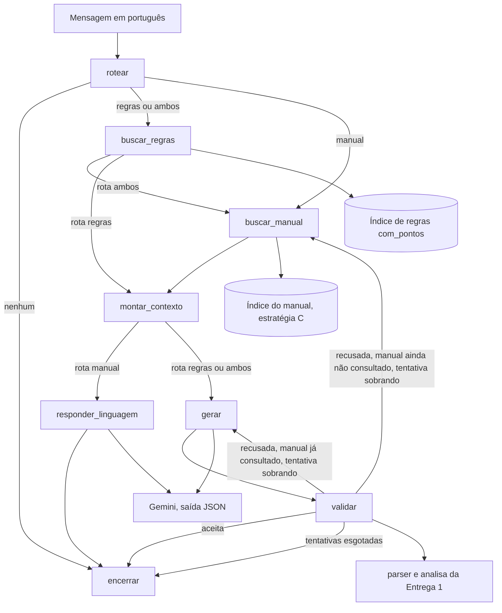

# Como este agente foi construído

Este texto descreve o repositório git cuja raiz é a pasta `trabalho/`, remoto `https://github.com/J3ssye/Multiagentes-Govendas-GOBR-`. O histórico local vai até o commit `5375da19fde056b58ea46f71d87714ca757ce8e2` (14/11/2026). Depois de um `git fetch` feito nesta análise, `origin/main` continua em `bb9b77997665f1608656e954f608ff4e91088ae3` (README da Entrega 4). Os dois commits da Entrega 5 existem só na máquina local: quem clonar o GitHub hoje não vê o agente. Os números de linha são os arquivos nesse commit local. Arquivos soltos fora do git (`entrega1.zip` a `entrega4.zip` e `prompt_revisao_harmonizacao.md`) não entram nesta explicação.

Quando o motivo de uma escolha está escrito pela autora no README ou na regra, a citação basta. Quando o motivo é conclusão desta leitura, a frase traz a palavra **inferência** e a base.

## 1. O projeto em linguagem simples

Uma empresa de vendas guarda, numa linguagem própria chamada GOBR, as regras de quem o vendedor deve ligar, de quanto em quanto tempo, e de quem deve ficar de fora da agenda. Essa linguagem é precisa para o sistema e opaca para quem pensa o comercial em português: "ativos a cada 14 dias, inadimplentes não entram". O trabalho da disciplina pede um programa de conversa que receba essa descrição e devolva o arquivo na linguagem do sistema, avisando o que ficou ambíguo ou furado na modelagem (`Trabalho da Disciplina de Multiagentes.pdf`, páginas 2 e 4).

O que está no repositório foi construído em cinco degraus, um commit de cada vez. Primeiro o programa aprendeu a ler os arquivos GOBR que a disciplina entregou e a explicar cada um em português. Depois guardou essas explicações num índice de busca, e guardou também o manual da linguagem noutro índice. Em seguida montou um fluxo que, para uma pergunta, busca exemplos parecidos e trechos do manual. Por último, um agente decide se a pessoa quer uma regra nova, uma explicação da linguagem, as duas coisas, ou algo fora do assunto, chama um modelo de linguagem para redigir o GOBR e só devolve o texto se um validador estrutural aceitar.

Quem usa, hoje, é a própria aluna avaliando o sistema, e no desenho final seria um gestor comercial que não programa. O programa ainda não lê imagem, embora o enunciado liste imagem como entrada (PDF, página 2; a própria regra da Entrega 5 registra essa omissão em `entrega5/regra_agente.md:21-23`). Também ainda não lembra o turno anterior. E a medição de qualidade da geração, prevista na regra, não foi commitada: não há `config_agente.json` nem `resultados_agente_dev.json` no repositório. O encanamento do agente está escrito e tem testes sem modelo; o número de "quantas regras geradas prestam" ainda não existe no git.

## 2. Mapa da arquitetura

O desenho final é o da Entrega 5. As Entregas 1 a 4 não foram apagadas: viraram bibliotecas importadas. Nenhum arquivo delas é editado pela entrega seguinte (`entrega5/regra_agente.md:31`; `entrega5/comum_agente.py:4-7`).

O caminho dos dados, em uma frase: a mensagem vira uma rota; a rota escolhe quais índices consultar; o que volta vira um texto de contexto; o modelo redige; o parser julga a forma; se a forma falha, o grafo pode buscar o manual e tentar de novo, no máximo duas vezes.

### Roteador

**Agente.** Analogia: um estagiário que lê o pedido, vai até a estante certa, redige um rascunho, confere o rascunho numa lista de regras e, se a lista recusar, reescreve uma vez. Definição: neste projeto, um fluxo com um modelo de linguagem dentro, ferramentas de busca e de análise, e um ciclo de correção com orçamento de tentativas. A autora registra que não achou no material da disciplina uma definição pronta de "fluxo agêntico" e adota essa (`entrega5/regra_agente.md:33`). Onde: o grafo em `entrega5/agente.py:203-225`.

**Roteador.** Analogia: a recepcionista que olha o assunto do e-mail e manda para o setor certo, sem redigir a resposta. Definição: função pura, sem modelo e sem token, que classifica a mensagem em uma de quatro rotas. Onde: `entrega5/comum_agente.py:121-141`, chamada pelo nó `rotear` em `entrega5/agente.py:86-90`.

Recebe a mensagem. Devolve `rota`, `motivo` e quatro booleanos (`dominio`, `pedido`, `pergunta`, `descricao`). Existe para não pagar a busca cara do manual quando a pessoa só descreveu uma regra de negócio. A Entrega 4 mandava toda pergunta aos dois índices; uma pergunta comercial trouxe trechos do manual com notas de 0,004 a 0,007 (`entrega4/README.md:182` e `entrega4/README.md:269`).

### Índices

**Índice de regras.** Analogia: uma ficha de biblioteca em que cada ficha é uma regra já explicada em português, e no verso está o GOBR inteiro. Definição: índice vetorial LlamaIndex da variante `com_pontos`, 199 regras, nenhuma dividida (`entrega2/README.md:65`). Onde a busca acontece: `entrega2/comum.py:286-301`, reusada por `entrega4/comum_fluxo.py:338-344` e por `entrega5/comum_agente.py:575-587`. Recebe a mensagem (ou, na avaliação, a mensagem com a regra-gabarito escondida). Devolve até 3 regras, cada uma com título, texto da explicação, nota e o GOBR completo (`entrega4/comum_fluxo.py:512-516`). Existe porque o enunciado pede recuperar exemplos parecidos (PDF, página 4).

**Índice do manual.** Analogia: o manual da linguagem picotado por seção, com o número da página ainda colado no pedaço. Definição: índice da estratégia C, um nó por folha da hierarquia do PDF, 94 nós (`entrega3/README.md:80`). Busca em `entrega3/comum_manual.py:351` via `buscar_cfg`. A configuração congelada pela Entrega 4 é vetor mais reranker com 5 candidatos e `max_length` 2048 (`entrega4/config_escolhida.json:6-16`). Recebe a mensagem, ou na retentativa uma pergunta montada das recusas (`entrega5/comum_agente.py:312-327`). Devolve até 3 trechos com folha e páginas (`entrega4/comum_fluxo.py:518-523`). Existe porque o enunciado pede o manual como apoio para escrever a saída (PDF, página 4).

### Contexto, geração, validação, encerramento

**Montagem de contexto.** Junta regras e trechos num único texto, com o GOBR inteiro dentro de uma cerca de código, sem cortar (`entrega4/comum_fluxo.py:543-564`). O nó do agente só chama essa função (`entrega5/agente.py:104-108`). Existe para o modelo ver exemplo e gramática no mesmo prompt, e para quem já consumia o JSON da Entrega 4 continuar lendo os mesmos campos (`entrega5/regra_agente.md:107`).

**Gerar.** Uma chamada ao Gemini com temperatura 0,2, saída JSON obrigatória (`gobr`, `premissas`, `perguntas`) e teto de 32768 tokens de saída (`entrega5/comum_agente.py:432-442`). Na segunda tentativa o prompt leva o GOBR recusado e a lista de problemas (`entrega5/comum_agente.py:360-385`). Existe para cumprir "devolver o conjunto de regras na linguagem GOBR" (PDF, página 2).

**Responder em linguagem.** Outra chamada, só na rota `manual`, com o prompt da Entrega 4, que não exige GOBR (`entrega5/agente.py:144-152` chama `comum_fluxo.responder`). Existe porque uma pergunta do tipo "como escrevo um E e um OU?" não é pedido de arquivo novo.

**Validador.** Roda `parse_texto` e um critério extra que o parser sozinho não aplica (`entrega5/comum_agente.py:252-296`). Recebe o campo `gobr`. Devolve `aceita`, recusas e avisos. Existe porque o parser nunca recusa: ele anexa em silêncio a linha que não sabe classificar (`entrega1/gobr_parser.py:238-239`; a regra explica isso em `entrega5/regra_agente.md:151`).

**Encerrar.** Monta status, pontos de atenção e tempos (`entrega5/agente.py:154-177`). Se a rota é `nenhum`, a resposta é a frase pronta de fora de escopo, com zero chamada ao modelo (`entrega5/comum_agente.py:370-372`). Se a validação falhou nas duas tentativas, o GOBR sai marcado `NÃO VALIDADO` (`entrega5/agente.py:278-284`).

### O que fica fora do desenho, de propósito

Imagem, memória entre turnos, um modelo escolhendo o próximo nó, vários agentes, busca paralela dos dois índices e execução da regra no Govendas de verdade. A lista está em `entrega5/regra_agente.md:109`. A memória é o título previsto da Entrega 6 (`entrega5/regra_agente.md:11`).

## 3. O caminho de uma pergunta

A mensagem abaixo está no arquivo de desenvolvimento do roteador, com rota esperada `ambos` (`entrega5/consultas_roteamento_dev.json:10`):

> Quero ligar para os clientes ativos a cada 14 dias e não agendar os inadimplentes. Como escrevo isso em GOBR?

Ela serve de exemplo porque passa pelos dois índices e pela geração. O texto que o Gemini devolveria não está no repositório: a Entrega 5 commitou o código e os testes sem modelo (`5375da1`), e não commitou uma execução com a API. O que segue é o caminho que o código toma. O uso interativo ainda depende de `config_agente.json`, que `main` exige e que não está no git (`entrega5/agente.py:322-326`).

**Passo 0. A linha de comando.** `main` em `entrega5/agente.py:319` lê a configuração de busca das regras, recusa seguir sem chave de API se não for `--sem-llm` (`entrega5/agente.py:330-332`), cria um `Buscador`, carrega índices e modelos fora do teto de 20 segundos (`entrega5/agente.py:334-337`) e compila o grafo (`entrega5/agente.py:338-339`). `executar` (`entrega5/agente.py:233-237`) entrega ao grafo só a mensagem. No uso interativo a lista `excluir` fica vazia: a regra parecida não é escondida. Esconder a regra de referência só acontece na avaliação, em `entrega5/avaliar_agente.py:205`.

**Passo 1. Rotear.** O nó `rotear` (`entrega5/agente.py:86-90`) chama `rotear` (`entrega5/comum_agente.py:121`). A função passa o texto para minúsculas e tira acentos (`entrega5/comum_agente.py:111-113`), corta em frases (`entrega5/comum_agente.py:116-118`) e calcula quatro marcas.

Nesta mensagem: há termos do léxico (`cliente`, `ativo`, `agend`, `inadimpl`, `gobr`; a lista está em `entrega5/comum_agente.py:60-63`), então `dominio` é verdadeiro. A segunda frase termina em `?` e não casa o padrão de "crie uma regra" (`PEDIDO_1`, `entrega5/comum_agente.py:69`), então `pergunta` é verdadeira e `pedido` é falso. A primeira frase casa "a cada 14" e "não agendar" (`DESC`, `entrega5/comum_agente.py:64-68`), então `descricao` é verdadeira. A tabela da função (`entrega5/comum_agente.py:131-139`) devolve rota `ambos` e o motivo "pergunta junto com uma descrição de regra". Zero token.

**Passo 2. A aresta depois de rotear.** `depois_de_rotear` (`entrega5/agente.py:185-187`) manda `regras` e `ambos` para `buscar_regras`, `manual` para `buscar_manual` e `nenhum` para `encerrar`. Aqui vai para `buscar_regras`.

**Passo 3. Buscar regras.** O nó (`entrega5/agente.py:92-95`) chama `Buscador.buscar_regras` (`entrega5/comum_agente.py:582-587`), que chama `buscar_cfg` (`entrega4/comum_fluxo.py:338-344`), que chama `buscar_regras` da Entrega 2 (`entrega2/comum.py:286-301`).

Por dentro, com a linha de base R0 (híbrido, sem reranker; é a configuração que a Entrega 4 escolheu e que a Entrega 5 só troca se alguma candidata tiver hit@3 estritamente maior, `entrega5/comum_agente.py:663-704`):

1. O retriever pede todos os nós do índice, ordenados por similaridade do vetor da consulta com o vetor de cada explicação (`entrega2/comum.py:294-296`).
2. `agrupar_por_regra` junta partes da mesma regra e fica com a de maior nota (`entrega2/comum.py:152-164`). No índice atual nenhuma regra foi dividida (`entrega2/README.md:65`), então o agrupamento não muda o ranking. Ele existe para o dia em que uma regra estourar o limite do modelo.
3. Como a fase 1 é híbrida, `fundir_rrf` soma esse ranking com o ranking BM25 (`entrega2/comum.py:297-298` e `entrega2/comum.py:259-275`).
4. Sem reranker, a função devolve os 3 primeiros (`k = 3`, `entrega5/comum_agente.py:40`).

Cada item que volta traz o GOBR completo, guardado como metadado e não como vetor (`entrega2/comum.py:127-134`). O relógio desse nó entra em `tempos_s["buscar_regras"]`.

**Passo 4. A aresta depois das regras.** `depois_de_buscar_regras` (`entrega5/agente.py:190-191`) vê rota `ambos` e `manual_consultado` falso, então segue para `buscar_manual`. Se a rota fosse só `regras`, iria direto a `montar_contexto` e o manual ficaria para uma eventual retentativa.

**Passo 5. Buscar manual.** O nó (`entrega5/agente.py:97-102`) usa a própria mensagem como consulta, porque `consulta_manual` ainda não foi preenchida. `Buscador.buscar_manual` (`entrega5/comum_agente.py:589-590`) busca no índice C com a configuração congelada: vetor, reranker, 5 candidatos, `max_length` 2048 (`entrega5/comum_agente.py:514-516` lendo `entrega4/config_escolhida.json:8`). O reranker relê a consulta junto com cada um dos 5 textos e reordena (`entrega2/comum.py:183-203`, reusado pelo manual). Voltam 3 trechos com seção e páginas. O nó marca `manual_consultado = True`.

**Passo 6. Montar contexto.** `montar_contexto` (`entrega4/comum_fluxo.py:543-564`) produz um texto com duas partes, "Regras de exemplo" e "Manual do GOBR". Nada é cortado: se uma das três regras tiver 22 mil caracteres de GOBR, o contexto leva os 22 mil (o tamanho máximo medido está declarado em `entrega4/README.md:272`). O contador de tokens do bge-m3 só informa o tamanho; não é a contagem que a API do Gemini vai cobrar (`entrega5/agente.py:107`).

**Passo 7. A aresta depois do contexto.** `depois_do_contexto` (`entrega5/agente.py:207-210`) manda a rota `manual` para `responder_linguagem`. Nas rotas `regras` e `ambos`, manda para `gerar`. Sem as funções de modelo injetadas (modo `--sem-llm`), manda para `encerrar` com status vazio: só roteamento, busca e contexto.

**Passo 8. Gerar.** O nó (`entrega5/agente.py:110-129`) monta o prompt com `montar_prompt_gerar` (`entrega5/comum_agente.py:380-385`). Na primeira tentativa não há GOBR anterior. `gerar_json` (`entrega5/comum_agente.py:432-442`) chama `generate_content` com instrução de sistema, temperatura 0,2, `response_mime_type` JSON e o schema de três campos (`entrega5/comum_agente.py:331-337`). O schema pede `gobr`, `premissas` e `perguntas`. As premissas são o que o modelo assumiu porque a descrição não dizia; as perguntas são os furos que ele acha na modelagem (`entrega5/comum_agente.py:347-349`). Isso é a tradução, nesta entrega, do "ser proativo" do enunciado: o programa não espera resposta, porque não há memória (`entrega5/regra_agente.md:23`).

`interpretar_saida` (`entrega5/comum_agente.py:388-401`) devolve `None` se o texto não for o JSON esperado ou se `gobr` vier vazio. A tentativa entra na lista `tentativas`, com número, tokens e segundos. Falha de rede, cota, autenticação ou tempo esgotado não conta como tentativa: `com_retentativa_infra` repete até duas vezes (`entrega5/comum_agente.py:454-469`). Se persistir, o status vira `erro_infra` e a aresta seguinte vai a `encerrar` (`entrega5/agente.py:220-221`).

**Passo 9. Validar.** O nó (`entrega5/agente.py:131-142`) chama `validar` (`entrega5/comum_agente.py:252-296`). A função:

1. Recusa string vazia como `saida_invalida`.
2. Chama `parse_texto` (`entrega1/gobr_parser.py:161-217`), que devolve a representação estruturada e já embute `analisa` (`entrega1/gobr_parser.py:216`).
3. Transforma avisos do parser em recusa `linha_nao_reconhecida`.
4. Recusa se não houver bloco `parametros`, se algum bloco não tiver fonte, se algum não tiver ação, ou se `analisa` achar `nao_agendar_com_frequencia` (`entrega1/gobr_parser.py:369-377`).
5. Roda `_varrer` (`entrega5/comum_agente.py:191-249`), um segundo passe que reproduz o ramo em que o parser cola uma linha desconhecida na cláusula anterior sem avisar (`entrega1/gobr_parser.py:238-239`). Isso vira `linha_de_corpo_nao_classificada`. Cabeçalho `parametros` que o `HEADER_RE` não reconhece vira `cabecalho_parametros_invalido`.
6. O que não recusa vira aviso: falta de `version`, cabeçalho de outro tipo não reconhecido, e os achados `bloco_inalcancavel`, `sem_regra_final`, `nome_diverge_do_codigo`, `fonte_indefinida` (`entrega1/gobr_parser.py:309-398`).

"Aceita" aqui quer dizer "a forma passou nesse critério". A própria saída impressa diz que isso não garante que o Govendas aceitaria a regra nem que ela faz o que foi pedido (`entrega5/agente.py:286-287`).

**Passo 10. A aresta depois de validar.** `depois_de_validar` (`entrega5/agente.py:194-200`):

- Aceita, ou já gastou `MAX_TENTATIVAS` (2, `entrega5/comum_agente.py:44`): vai a `encerrar`.
- Recusada, ainda há tentativa, e o manual não foi consultado, e existe uma pergunta montada das recusas: volta a `buscar_manual`. A pergunta sai da tabela `CONSULTA_MANUAL` (`entrega5/comum_agente.py:300-327`), usando no máximo as duas primeiras recusas. Exemplo: `bloco_sem_fonte` vira "Como declaro a fonte de clientes (do time ou da carteira) de um bloco parametros?". `saida_invalida` não busca.
- Recusada, tentativa sobrando, manual já consultado: volta a `gerar`, agora com o GOBR anterior e a lista de problemas no prompt.

Nesta mensagem a rota já consultou o manual no passo 5. Uma recusa na primeira tentativa não busca de novo: a segunda chamada ao Gemini recebe o contexto que já inclui o manual. Isso está escrito na regra (`entrega5/regra_agente.md:102`).

**Passo 11. Encerrar e imprimir.** `encerrar` define o status `aceita` ou `invalida`, junta avisos do validador, premissas e perguntas em `pontos_de_atencao`, soma o tempo das duas buscas e o tempo do turno (`entrega5/agente.py:154-177`). `formatar_saida` (`entrega5/agente.py:266-301`) mostra a rota, as fontes, o GOBR e, se recusado, a marca `NÃO VALIDADO` mais os códigos de recusa. Os tokens impressos são os que a API devolveu em `usage_metadata` (`entrega5/comum_agente.py:421-429`), somados por `_soma_tokens` (`entrega5/agente.py:75-81`). Isso corrige, sem editar a Entrega 4, o defeito em que a linha de tokens era impressa antes da chamada (`entrega4/README.md:249`; `entrega5/regra_agente.md:37`).

**Os outros três desfechos, no mesmo código.** Uma frase declarativa só com termos do domínio, sem `?`, segue `regras` e só busca o manual se a validação recusar. Uma pergunta de linguagem sem descrição de frequência ou de bloqueio segue `manual`, chama `responder_linguagem` e não passa pelo validador. "Qual a previsão do tempo para amanhã em Goiânia?" (`entrega5/consultas_roteamento_dev.json:7`) não tem termo do léxico, segue `nenhum`, não busca e não chama o modelo.

**O que a avaliação faria de diferente com a mesma frase, se ela fosse uma consulta de geração.** `rodar_geracao` passaria em `excluir` os caminhos listados em `relevantes` (`entrega5/avaliar_agente.py:205`). `buscar_regras` pede `k + len(excluir)` e tira esses ids antes de cortar em 3 (`entrega5/comum_agente.py:582-587`). O id no índice é o caminho relativo, como `referencias/regra_001.gobr` (`entrega1/saida/explicacoes.jsonl`, campo `id`; `entrega2/comum.py:116`). O gabarito das consultas usa o mesmo formato (`entrega2/consultas_avaliacao.json:8`). A comparação casa. O que ela não impede, e a regra admite, é copiar uma regra vizinha que ficou no índice (`entrega5/regra_agente.md:333`).

## 4. Linha do tempo: commit a commit

São 13 commits, de 20/10/2026 a 14/11/2026, autora registrada no git como Jessyca. A ordem reproduz as dicas do enunciado (PDF, página 4): traduzir as regras, indexar as descrições, indexar o manual, cuidar do corte dos pedaços, montar um fluxo. **Inferência:** o calendário das entregas da disciplina empurrou um commit grande por etapa; a evidência é que cada assunto estreia num commit cujo título é "Entrega N", e o código da etapa seguinte só importa a anterior.

### 4.1 `7f5bc7f` — 20/10/2026 — Entrega 1: geração de explicações das regras GOBR

**O que mudou.** Entram o corpus (`referencias/regra_001.gobr` até `regra_246.gobr`, três exemplos em `exemplos/`, o PDF do enunciado, o manual `govendas-rules.pdf`), o parser (`entrega1/gobr_parser.py`), o glossário (`entrega1/glossario.py`), a ficha e a verificação (`entrega1/explicacao.py`), a orquestração com o Gemini (`entrega1/gerar_explicacoes.py`), os prompts e as saídas em `entrega1/saida/`. O README descreve o pipeline (`entrega1/README.md:35-51`).

**Qual problema isso resolvia.** Havia centenas de arquivos numa linguagem que o modelo não devia "interpretar no olho". Se o modelo lesse o `.gobr` cru, ninguém provaria que ele não pulou um bloco. O README descarta essa alternativa com essa frase (`entrega1/README.md:55-57`).

**Opções possíveis.** (1) Mandar o arquivo cru ao modelo e confiar no texto. (2) Um parser determinístico produz uma ficha, e o modelo só redige. (3) Não usar modelo: a explicação determinística é a entrega final.

**Opção tomada.** A (2), com a (3) de reserva. `gera_uma` chama o modelo, `verifica` confere estrutura e números, e se falhar manda a lista de problemas numa segunda tentativa (`entrega1/gerar_explicacoes.py:212-229`, `max_tentativas=2`). Se a chave ou a cota falharem, fica a explicação determinística (`entrega1/README.md:105-106`).

**Por que ela é melhor ou pior que as outras.** A (1) é mais rápida de escrever e impossível de auditar: uma frase pode omitir um bloco e continuar elegante. A (2) separa duas tarefas que têm critérios diferentes. Ler a sintaxe é uma função de cadeias e expressões regulares, assunto de compiladores e de processamento de texto, que um aluno de Sistemas de Informação já pratica. Redigir para um gestor é o que o modelo faz bem. A (3) é mais barata e mais fiel, e o README mostra que ela existe (`explicacao_deterministica`). Ela perde em estilo: o enunciado pede descrições parecidas com as imagens (PDF, página 4), e as imagens são texto corrido de negócio, não um despejo de campos. Ficar só com a (3) cumpriria a fidelidade e perderia o formato que a dica pede. O custo da (2) é manter o parser sincronizado com a linguagem. O próprio README cita o aviso do livro de que um módulo de explicação separado precisa ser construído, depurado e mantido junto do sistema (`entrega1/README.md:56`).

**O que essa decisão custou.** O parser classifica pela palavra inicial, não pela indentação, porque os arquivos misturam tab e espaço (`entrega1/gobr_parser.py:20-21`; `entrega1/README.md:58-67`). Isso acerta o corpus e cria o buraco que a Entrega 5 vai ter de tapar: uma linha que não classifica é colada na cláusula anterior sem aviso (`entrega1/gobr_parser.py:238-239`). O `HEADER_RE` exige aspas em volta do nome (`entrega1/gobr_parser.py:70-73`). Um cabeçalho `parametros` malformado não abre bloco novo; some dentro do anterior. Dos 249 arquivos, 199 textos são únicos: a deduplicação compara um hash SHA-1 do texto com espaços colapsados (`entrega1/gobr_parser.py:405`; `entrega1/README.md:75-76`). Uma regra aparece 48 vezes no campo `duplicatas` de `regra_001` (visível em `entrega1/saida/explicacoes.jsonl`). Indexar as cópias faria o mesmo vetor ocupar o topo da busca. **Inferência:** esse descarte foi pensado já para a entrega seguinte; a evidência é o README dizer que as cópias dominariam a indexação (`entrega1/README.md:76`) e o `texto_indexavel` ser anunciado como "o que será transformado em embedding" (`entrega1/explicacao.py:134-137`).

A verificação confere contagem de segmentos, presença de `nao agendar`, números de frequência e de filtro (`entrega1/README.md:96-101`). Ela não confere se a frase está bem escrita (`entrega1/README.md:134`). Few-shot com leave-one-out: ao explicar um dos três exemplos, ele não entra como exemplo de si mesmo (`entrega1/gerar_explicacoes.py:109`). Temperatura 0,2 e JSON com schema (`entrega1/README.md:92-93`).

**Termos novos.**

**DSL e GOBR.** Analogia: a planilha que a empresa inventou, com meia dúzia de palavras (`parametros`, `quando`, `frequencia`, `nao agendar`), em vez de uma linguagem geral. Definição: Domain-Specific Language, uma linguagem desenhada para um domínio. GOBR é a DSL de parametrização comercial do Govendas. O enunciado usa GOBR; o manual também escreve gorules e GoBR (`entrega3/README.md:40`). Onde: o cabeçalho do parser, `entrega1/gobr_parser.py:1-18`.

**Parametrização.** Analogia: os botões da agenda do vendedor, "de quanto em quanto tempo" e "quem fica de fora", gravados como dados e não como código solto. Definição: no Govendas, um conjunto de blocos `parametros` que o sistema avalia em ordem. Um cliente encaixado num bloco não é reprocessado nos seguintes (o parser comenta o Manual §7.6 em `entrega1/gobr_parser.py:312-315`). Onde: os blocos do exemplo `exemplos/V1Vidros-RegraComercial.gobr:10-38`.

**Parser.** Analogia: alguém que lê um contrato e preenche uma ficha de campos fixos, sem opinar se o contrato é justo. Definição: analisador sintático determinístico. Aqui, `parse_texto` transforma o texto numa estrutura com versão, times, carteiras, blocos, filtros e ações. Onde: `entrega1/gobr_parser.py:161`.

**Representação estruturada.** Analogia: a ficha, não o contrato. Definição: o dicionário que o parser devolve. No código a variável se chama `ir`. Onde: `entrega1/gobr_parser.py:206-217`.

**LLM, prompt, few-shot, temperatura, schema e token.** Analogia do LLM: um redator muito lido, que completa o texto no estilo dos exemplos que você pôs na mesa, e que inventa com fluência quando a mesa está vazia. Definição: modelo de linguagem grande, aqui o Gemini (`gemini-3.8-flash` é o padrão citado em `entrega1/README.md:26`). Prompt é o texto de instrução; o de sistema está em `entrega1/prompts/sistema.md`. Few-shot é dar exemplos de entrada e saída antes da tarefa real (`entrega1/gerar_explicacoes.py:105-112`). Temperatura é o quanto o modelo pode variar; 0,2 pede texto estável (`entrega1/README.md:93`). Schema é o formato obrigatório da resposta, para o programa conseguir ler sem adivinhar. Token é o pedaço em que o modelo conta texto; não é palavra, não é caractere, e a contagem muda de modelo para modelo. Onde a Entrega 1 gasta token: cada chamada em `gera_uma`.

**Verificação e validação.** Analogia: verificação é conferir se a redação citou todos os números da ficha; validação é perguntar ao gestor se a ficha era o que ele queria. Definição: a autora usa essa distinção do livro e a aplica assim (`entrega1/README.md:102-103`). `verifica` é a verificação (`entrega1/explicacao.py:172`). A comparação com as três imagens é o que ela chama de validação (`entrega1/README.md:116-117`). Onde: `avalia_contra_imagens` em `entrega1/gerar_explicacoes.py:304`.

**Hash e deduplicação.** Analogia: duas folhas que, tirando os espaços, são a mesma folha, contam como uma. Definição: SHA-1 do texto normalizado identifica o conteúdo (`entrega1/gobr_parser.py:405`). Deduplicar é guardar uma vez e listar as cópias. Ligação com banco de dados: é uma chave natural do conteúdo, diferente da chave do nome do arquivo. Onde: `entrega1/gerar_explicacoes.py:90-97`.

### 4.2 `e090c52` — 27/10/2026 — Entrega 2: indexação, busca híbrida e conjunto de teste

**O que mudou.** Entram `entrega2/comum.py`, `indexar.py`, `buscar.py`, `avaliar.py`, `teste_plumbing.py`, `consultas_avaliacao.json` (14 consultas) e `consultas_teste.json` (20). O README desta época ainda será reescrito no commit seguinte; o comportamento que permanece está no código deste commit, porque o commit de resultados não muda `.py` (o `--stat` de `09c17d8` só lista README e dois relatórios).

**Qual problema isso resolvia.** A Entrega 1 produziu texto. O enunciado pede indexar essas descrições e usá-las num RAG (PDF, página 4). Sem índice, o agente da entrega final não teria exemplos para imitar.

**RAG.** Analogia: na prova com consulta, você primeiro acha as páginas certas e só depois escreve, em vez de escrever de memória. Definição: Retrieval-Augmented Generation, geração aumentada por recuperação. O modelo recebe, junto com a pergunta, trechos buscados num acervo. Onde o nome aparece como entrega: `entrega4/fluxo.py:1-10`. O índice que alimenta essa recuperação nasce aqui.

**Opções possíveis.** (1) Cortar cada explicação em pedaços de tamanho fixo, com sobreposição, como a atividade de RAG da disciplina faz com manuais. (2) Um nó por regra, e o código GOBR inteiro vai no metadado, fora do vetor. (3) Embedding da API do Gemini, em vez de um modelo local.

**Opção tomada.** A (2), com o modelo local bge-m3 (`entrega2/comum.py:17` e `entrega2/comum.py:316-318`). O texto que vira vetor é título, resumo e um segmento por linha (`entrega2/comum.py:53-65`). Metadados, inclusive `gobr`, ficam em `excluded_embed_metadata_keys` (`entrega2/comum.py:129-135`). Se o texto estourar o limite, a divisão é por segmento, repetindo título e resumo (`entrega2/comum.py:69-92`). A busca devolve a regra, não o pedaço (`entrega2/comum.py:152-156`).

**Por que ela é melhor ou pior que as outras.** A (1) é o caminho da biblioteca e o da aula. Ela é pior aqui porque o enunciado alerta para a quebra dos pedaços (PDF, página 4) e uma regra cortada ao meio, se recuperada, ensinaria meia regra ao modelo. A autora registra que não achou no material discussão de tamanho de chunk (`entrega2/README.md:40`). A (3) gastaria cota a cada consulta das entregas seguintes (`entrega2/README.md:44`). O modelo local custa disco (o README fala em cerca de 2 GB no primeiro download, `entrega2/README.md:12`) e CPU, e a mesma função gera o vetor na indexação e na consulta, que é o que faz a geometria prestar (`entrega2/README.md:44`).

**Embedding e índice vetorial.** Analogia: cada texto vira um ponto num mapa; textos parecidos caem perto. Definição: um embedding é um vetor de números produzido por um modelo (aqui bge-m3). O índice guarda esses vetores e, na consulta, devolve os de maior similaridade. Ligação com banco de dados: é um índice secundário, só que a chave não é igualdade e sim vizinhança. Onde: `criar_embedding` e `carregar_indice` em `entrega2/comum.py:308-318`.

**Metadado.** Analogia: o verso da ficha, que você lê depois de achar a ficha, e que não entra na ordenação. Definição: campos guardados junto do nó e excluídos do cálculo do vetor. Sem essa exclusão, o LlamaIndex concatenaria o metadado ao texto e o GOBR inteiro viraria vetor (`entrega2/comum.py:98-101`). Onde: `entrega2/comum.py:114-135`.

**Chunk.** Analogia: o pedaço que a busca é capaz de devolver. Definição: a unidade indexada. Nesta entrega a unidade é a regra inteira, salvo estouro do limite. Onde: `dividir_texto`, `entrega2/comum.py:69`.

**O que essa decisão custou.** Regras longas continuam longas. O README da Entrega 4 vai medir nós de até 4.136 tokens do bge-m3 e um GOBR de 22.311 caracteres (`entrega4/README.md:272`; a mediana e o máximo também estão na regra da Entrega 5, `entrega5/regra_agente.md:229`). Isso ainda não dói na busca vetorial. Vai doer no reranker, que relê o texto.

Entram também, já neste commit, as peças que a avaliação compara: reranker opcional e busca híbrida opcional. O padrão de linha de comando continua `sem_pontos` (`entrega2/README.md:110`). O conjunto de teste é sorteado com `random.seed(20261027)` entre regras que não estão no desenvolvimento, e as consultas são escritas antes de rodar a busca (`entrega2/README.md:59`).

**Reranker e cross-encoder.** Analogia: a primeira peneira é rápida e grossa; um revisor lento relê só os finalistas, com a pergunta na mão. Definição: a primeira fase traz N candidatos por similaridade de vetor. A segunda fase é um cross-encoder: o modelo lê o par (consulta, texto) junto e devolve uma nota de relevância. O código usa `BAAI/bge-reranker-v2-m3` com `max_length` 2048, porque o reranker pronto do LlamaIndex fixa 512 e cortaria as regras grandes (`entrega2/comum.py:18-21` e `entrega2/comum.py:183-203`). Quem fica fora dos N candidatos não sobe, mesmo que fosse o texto certo (`entrega2/comum.py:186-189`).

**BM25.** Analogia: o Ctrl+F que sabe que "14" e "28" são palavras diferentes, e que uma palavra rara vale mais que "de" e "para". Definição: função de ranking por termos. A nota de um documento sobe quando os termos da consulta aparecem nele, ponderados por quão raros são no acervo (idf) e por quão longos os documentos são. Implementação própria, k1 = 1,5 e b = 0,75 (`entrega2/comum.py:216-245`). A autora diz que esses números são usuais na literatura e não estão no material (`entrega2/README.md:49`). Ligação com banco de dados e com recuperação de informação: é o parente do índice invertido, a estrutura que mapeia termo para documentos. O código não monta um índice invertido explícito; conta frequência por documento na hora (`Counter` em `entrega2/comum.py:228`). Com 199 documentos isso é barato. **Inferência:** por isso não valeu a pena uma biblioteca de busca lexical; a evidência é o tamanho do corpus no README e a implementação caber em uma classe.

**Busca híbrida e RRF.** Analogia: duas listas de chamada, a do "assunto parecido" e a do "número exato", fundidas sem discutir de quem é a nota, só a posição. Definição: Reciprocal Rank Fusion. A nota de um item é a soma de `1 / (60 + posição)` em cada ranking (`entrega2/comum.py:259-275`). k = 60 também é declarado como valor de literatura ausente do material. Um item em 1º num ranking e 10º no outro recebe `1/61 + 1/70`. Dois 2º lugares recebem `1/62 + 1/62`. Não se compara a nota do vetor com a nota do BM25, porque estão em escalas diferentes. Onde a fusão entra na busca: `entrega2/comum.py:297-298`.

**hit@k e MRR.** Analogia: hit@3 é "a regra certa ficou no pódio?"; MRR é "em média, quão perto do topo ela ficou?". Definição: hit@k é a fração das consultas cuja regra certa está entre as k primeiras. MRR é a média de 1/posição da primeira regra certa; se ela não aparece, conta zero (`entrega2/avaliar.py:47-63`; a frase está em `entrega2/README.md:52`). O gabarito é o id exato. Com regras quase iguais, o id exato pode ser inatingível e mesmo assim entra na conta (`entrega2/README.md:116`). Ligação com avaliação experimental em engenharia de software: métrica definida antes, conjunto que decide separado do conjunto que só relata.

**Conjunto de desenvolvimento e conjunto de teste.** Analogia: a prova que você usa para escolher a fórmula, e a prova lacrada que você abre uma vez no fim. Definição: desenvolvimento escolhe variante, reranker e híbrido; teste só relata (`entrega2/README.md:55-61`). A autora apoia isso no capítulo 19 do AIMA, como analogia, e registra que não achou no material a aplicação a um pipeline de busca. Onde: `consultas_avaliacao.json` e `consultas_teste.json`.

**O que mais custou.** As consultas foram escritas por quem leu as regras, então repetem o vocabulário delas e favorecem o BM25 (`entrega2/README.md:114`). O número mede comparação entre configurações. Ele não estima um usuário real.

### 4.3 `09c17d8` — 03/11/2026 — Entrega 2: resultados e o desvio do padrão

**O que mudou.** Só documentação e resultados: `entrega2/README.md`, `resultados_avaliacao_rerank_hibrido.md`, `resultados_teste_rerank_hibrido.md`. Nenhum `.py`. O README passa a dizer que o padrão para as entregas seguintes é `com_pontos` + híbrido + rerank de 50 candidatos, e que isso é desvio do protocolo original (`entrega2/README.md:105-110`).

**Qual problema isso resolvia.** O README original, segundo o próprio texto reescrito, tinha fixado `sem_pontos` comparando as variantes só na busca vetorial (MRR 0,452 contra 0,390). A tabela completa do desenvolvimento inverte a ordem quando há reranker ou híbrido. O maior MRR das 8 combinações é `com_pontos` + híbrido + rerank(50), MRR 0,766 no desenvolvimento (`entrega2/README.md:80-82`). No teste, essa combinação teve MRR 0,827; as melhores linhas do teste ficam 0,017 acima e não mudam a escolha, porque a regra decide no desenvolvimento (`entrega2/README.md:103`).

**Opções possíveis.** (1) Manter `sem_pontos`, porque era o que estava escrito antes de ver a tabela. (2) Reescrever a regra de escolha para "maior MRR entre as 8" e adotar `com_pontos`. (3) Rodar um experimento novo, com a regra das 8 combinações escrita antes de qualquer número.

**Opção tomada.** A (2), declarada como desvio. O código de `buscar.py` e `indexar.py` continua com `sem_pontos` como valor padrão da flag (`entrega2/README.md:110`). As entregas seguintes têm de passar a variante na mão.

**Por que ela é melhor ou pior que as outras.** A (1) seria fiel ao papel e infiel ao critério que o próprio papel dizia usar ("vale o maior MRR"). A (2) aplica o critério à tabela inteira e avisa o leitor. Ela é pior do que a (3): escolher a família de comparações depois de ver os números é grau de liberdade do experimentador. A diferença que justifica a troca é pequena, e o README diz isso com conta (`entrega2/README.md:108`): 0,067 de MRR em 14 consultas equivale a cerca de 0,94 de soma de rank recíproco, o que duas consultas subindo do 2º para o 1º lugar já produzem. Não há teste de significância; a autora diz que não achou critério no material. A (3) seria a opção mais limpa e custaria outra rodada de CPU. Para um trabalho com prazo, a (2) com desvio escrito é defensável. Para uma banca rigorosa, a frase certa é: "eu alarguei a regra depois de ver o desenvolvimento; o teste não entrou na escolha; a margem é fina".

**O que essa decisão custou.** Quem ler só o `--help` dos scripts da Entrega 2 usa a variante que perdeu. A Entrega 4 precisa lembrar de pedir `com_pontos`. Também ficou gravado que `com_pontos` sozinho, sem reranker, é pior que `sem_pontos` (MRR 0,390 contra 0,452, `entrega2/README.md:84`). Os pontos de atenção ajudam quando o reranker relê o texto, e atrapalham quando só o vetor decide. **Inferência:** o defeito da regra ("não há bloco final") não se parece com o pedido do usuário ("ativos a cada 14 dias"), então no vetor ele é ruído; o reranker, lendo pergunta e texto juntos, consegue ignorar esse ruído. A base é a inversão da tabela, não um comentário da autora.

**Termos novos.** Nenhum conceito de arquitetura. Entra o nome **desvio declarado**: mudança de protocolo escrita depois do resultado, sem reescrever o passado como se a regra nova sempre tivesse existido. Onde: a seção "Ajustes feitos olhando resultado" do README da Entrega 2.

### 4.4 `c7c956f` — 03/11/2026 — Entrega 3, passos 4 e 5.1: extração do manual e conjuntos, antes de indexar

**O que mudou.** `extrair_manual.py`, `teste_extracao.py`, `conjuntos_manual.py`, as 15 consultas de desenvolvimento, as 20 de teste, `saida/manual_blocos.jsonl` (380 blocos) e `saida/manual_limpo.md`. Ainda não há índice.

**Qual problema isso resolvia.** O manual é um PDF de 62 páginas (`entrega3/README.md:33`). Indexar o PDF bruto misturaria cabeçalho, rodapé, sumário e coluna de tabela lida na ordem errada. E escrever as consultas depois de ver a busca deixaria o gabarito contaminado.

**Opções possíveis.** (1) Deixar o LlamaIndex ler o PDF com o leitor padrão. (2) Extrair com código blocos tipados (título, parágrafo, tabela, código), limpar ruído, e só então indexar. (3) Transcrever o manual à mão.

**Opção tomada.** A (2). Página impressa = página do PDF menos 4 (`entrega3/extrair_manual.py`, função `pagina_impressa`; o README confirma em `entrega3/README.md:34`). Tabelas são lidas por célula (`entrega3/README.md:39`). Código preserva indentação. Títulos saem da fonte Helvetica-Bold, não do outline do PDF, que só marca capítulos (`entrega3/README.md:35`). Os conjuntos foram commitados antes de existir índice (`entrega3/README.md:66`). O teste das folhas usa `random.Random(20261102)` (`entrega3/README.md:64`).

**Por que ela é melhor ou pior que as outras.** A (1) é menos código e mais sujeira. Uma tabela lida por linha mistura colunas, e o reranker depois "confirma" essa mistura com uma nota alta. A (3) é a mais fiel e não cabe no prazo: 62 páginas, 47 tabelas, 47 blocos de código (`entrega3/README.md:38`). A (2) é a opção de engenharia de dados: o documento vira registros com tipo, folha e página, que é o que um banco de dados chamaria de esquema. Treze testes de extração (`entrega3/teste_extracao.py`) travam hierarquia, ruído, página impressa e tabela que continua na página seguinte. Isso é teste de regressão em cima de um parser de PDF, a mesma ideia da Entrega 1.

**O que essa decisão custou.** O extrator depende da maquete gráfica desta versão do manual (tamanho de fonte 16, 12 e 9,5). Uma edição nova do PDF com outra fonte quebra a hierarquia sem o Git avisar. **Inferência:** o acoplamento à fonte é o preço de o outline do PDF ser incompleto; a evidência é o README dizer que o outline só marca capítulos (`entrega3/README.md:35`).

**Termos novos.** Nenhum de arquitetura de agente. Entra **folha**: a unidade de gabarito do manual, uma subseção, uma seção ou a abertura de um capítulo (`entrega3/README.md:46`). O acerto da busca será "a folha certa voltou", não "o caractere certo voltou".

### 4.5 `3250d98` — 03/11/2026 — Entrega 3, passo 5: chunking, indexação, busca e a regra de escolha

**O que mudou.** `comum_manual.py`, `indexar_manual.py`, `buscar_manual.py`, `avaliar_manual.py`, `teste_plumbing_manual.py`, `requirements.txt`. A regra de escolha fica no código antes da indexação: o README diz que este commit é 12:47 e a indexação foi 12:52 (`entrega3/README.md:73`).

**Qual problema isso resolvia.** Com os blocos extraídos, ainda faltava decidir o que é um chunk do manual. Um chunk ruim devolve meia tabela ou meia seção, e o modelo escreve GOBR com meia gramática.

**Opções possíveis.** (1) Estratégia C: um nó por folha, trilha de títulos no texto, teto de 512 tokens, corte só em fronteira de bloco, tabela ou frase, código nunca cortado, sobreposição zero. (2) Estratégia B: o texto limpo inteiro no `SentenceSplitter` do LlamaIndex, 256 tokens, 32 de sobreposição, os números da atividade de RAG para manuais. (3) Estratégia A, semântica: o corte sai da similaridade entre frases e ignora título, tabela e código.

**Opção tomada.** Implementar C e B, descartar A a priori, e deixar o desenvolvimento escolher (`entrega3/README.md:42-48`). O reranker, o BM25 e o RRF são importados da Entrega 2 sem editar aquele código (`entrega3/README.md:170-172`). O RRF do manual foi reescrito chaveado pelo id do nó, porque não há "regra" para agrupar.

**Por que ela é melhor ou pior que as outras.** A (3) joga fora a estrutura que o extrator acabou de recuperar. A autora descarta A porque a receita da aula é para artigos (`entrega3/README.md:48`). A (2) é o controle: se C não ganhar de um corte burro e conhecido, C não merecia o código. A (1) é a que respeita a dica do enunciado sobre a quebra. Usar 512 como teto, e não como tamanho alvo, é escolha de engenharia em cima do `chunk_size` da aula (`entrega3/README.md:52`). Sobreposição zero é defendida porque o corte cai em fronteira e a trilha se repete em cada parte (`entrega3/README.md:54`). Isso é o oposto do motivo pelo qual a aula usa sobreposição (não perder o fio entre cortes arbitrários). As duas razões podem ser verdadeiras ao mesmo tempo, em documentos diferentes.

**O que essa decisão custou.** A métrica oficial favorece C: em B, a folha principal é a que tem mais caracteres dentro do chunk, e 27 das 90 folhas nunca são a principal de chunk nenhum (`entrega3/README.md:81-83`). A autora viu isso com um tokenizador falso, antes de qualquer busca, e acrescentou uma métrica de sensibilidade (acerto também se o chunk cobre pelo menos 50% dos caracteres da folha). O limite de 50% não está no material (`entrega3/README.md:72`). Sem essa segunda régua, "C é melhor" seria em parte um artefato da régua. Com a segunda régua, no desenvolvimento, B com rerank chega a MRR 0,791 contra 0,772 de C (`entrega3/README.md:110-111`). A escolha oficial continua sendo C, porque a regra oficial foi a que estava commitada. Isso é honesto e também é um exemplo de a métrica mandar no vencedor.

**Termos novos.** Nenhum além de folha, já introduzida. A ideia nova é **controle experimental**: B não é candidata a produção por estética; é a condição contra a qual C tem de ganhar.

### 4.6 `e08c64f` — 03/11/2026 — Entrega 3: índices, avaliação e o padrão C + vetor + rerank

**O que mudou.** Os índices `indice_manual_C` e `indice_manual_B`, os relatórios, os resultados de desenvolvimento e de teste, o README, e três linhas em `comum_manual.py` que gravam o padrão escolhido (`ESTRATEGIA_PADRAO`, `RERANK_PADRAO`, `HIBRIDO_PADRAO`).

**Qual problema isso resolvia.** Havia oito combinações (2 estratégias × 4 recuperações). Alguém tinha de ficar sendo o padrão das entregas seguintes.

**Opções possíveis.** (1) Maior MRR no desenvolvimento, com desempate por hit@1, depois configuração mais simples, depois estratégia C. (2) Escolher pelo teste, onde o híbrido sem rerank em C tem hit@3 0,90. (3) Escolher pela métrica de sensibilidade, onde B com rerank ganha no desenvolvimento.

**Opção tomada.** A (1). C + vetor + rerank empata em MRR 0,772 e em hit@1 0,60 com C + híbrido + rerank, e o desempate "mais simples" fica com o vetor (`entrega3/README.md:113`). As duas deram a mesma posição nas 15 consultas. O README oferece a explicação: com 94 nós e 50 candidatos, o reranker relê mais da metade do índice, e a primeira fase quase não muda o topo (`entrega3/README.md:113`). No teste, o padrão teve MRR 0,785 e hit@1 0,75 (`entrega3/README.md:142`).

**Por que ela é melhor ou pior que as outras.** A (2) abriria o envelope do teste para decidir, o que anula o teste. A (3) mudaria a régua depois de ver quem ganha. A (1) segue o papel. O desempate "mais simples" é razoável quando as posições são idênticas: híbrido custa um BM25 que, nesse empate, não moveu ninguém. O custo de CPU do reranker com 50 candidatos fica escrito: cerca de 1 segundo por par, perto de 50 segundos por pergunta (`entrega3/README.md:148`). O README deixa isso como ponto em aberto para as Entregas 4 a 6. Essa frase é o gancho da decisão mais importante da entrega seguinte.

**O que essa decisão custou.** O padrão carrega um reranker de 50 candidatos que, no fluxo interativo, não cabe. A Entrega 4 vai ter de reabrir o N. E a variante do manual ficou decidida com N = 50; ninguém reavaliou C contra B com N = 5. **Inferência:** é possível que, com poucos candidatos, a primeira fase (vetor contra híbrido) passe a importar, justo porque o reranker não relê mais metade do índice. A base é a explicação do empate no README (`entrega3/README.md:113`) somada ao N = 5 que a Entrega 4 vai medir.

### 4.7 `279a9a4` — 08/11/2026 — Entrega 4: a regra de escolha, antes de desenvolver

**O que mudou.** Um arquivo: `entrega4/regra_escolha_fluxo.md`, 154 linhas. Sem código, sem resultado.

**Qual problema isso resolvia.** A Entrega 3 mostrou que o reranker de 50 candidatos custa cerca de 50 segundos. Um fluxo que a pessoa espera não pode pagar isso. Se a grade de configurações fosse escrita depois de ver os tempos, a escolha seria história contada para trás.

**Pré-registro.** Analogia: o protocolo do experimento, datado e guardado antes de abrir os tubos. Definição: um texto commitado que fixa grade, métrica, teto e o que o teste pode fazer, de modo que o git prova a data. Onde: este commit, e a trava que o código do commit seguinte vai consultar.

**Opções possíveis.** (1) Fixar no papel a dupla "híbrido sem reranker nas regras, vetor com N pequeno no manual" e não medir o resto. (2) Medir uma grade larga, com teto de latência, e escrever a regra de desempate antes. (3) Deixar o modelo escolher, a cada pergunta, quantos candidatos reler.

**Opção tomada.** A (2). O README da Entrega 4, escrito depois, resume a grade: fase 1 vetor ou híbrida, sem reranker ou com N em {5, 10, 20, 50}, `max_length` 512 e 2048 nas regras e só 2048 no manual, 28 configurações (`entrega4/README.md:73`). Teto de 20 segundos para a soma das duas buscas, no computador de quem entrega (`entrega4/README.md:71`). k = 3. A regra de escolha: entre as duplas que cabem no teto, maior soma de hit@3, depois soma de MRR, depois menor latência, depois a mais simples (`entrega4/README.md:74`). Quem escolhe é o desenvolvimento; o teste só relata (`entrega4/README.md:72`).

**Por que ela é melhor ou pior que as outras.** A (1) é mais curta e cega: o número 20 e o N = 5 seriam chute. A (3) gasta uma chamada de modelo para decidir um hiperparâmetro que não depende da pergunta, e reabre a cada turno um custo que se quer limitar. A (2) é a opção de um experimento com orçamento. Ela é pior que um desenho que separasse "qualidade máxima, para lote" de "qualidade que cabe na conversa". O teto único força a qualidade a perder quando o relógio estoura, mesmo que o acerto no teste da Entrega 2 fosse maior. O número 20 não está no material; a autora cita só a frase do DMAS de que uso interativo pede latência baixa (`entrega4/README.md:71`).

**O que essa decisão custou.** O teto é o pior caso de cada índice, somado, e os dois índices são medidos com consultas diferentes (`entrega4/README.md:166`). Uma pergunta real não é a pior consulta de regras mais a pior consulta de manual ao mesmo tempo. **Inferência:** o teto é conservador demais para a experiência do usuário e, ao mesmo tempo, frouxo demais como garantia, porque o carregamento dos modelos fica fora dele (dezenas de segundos, `entrega4/README.md:108`). A base são as próprias ressalvas do README (`entrega4/README.md:271`).

**Termos novos.**

**Workflow.** Analogia: uma linha de montagem em que cada estação faz uma coisa e a próxima estação está escrita no chão, não na cabeça do operário. Definição: fluxo de passos fixos. A Entrega 4 escolhe workflow determinístico em Python, sem grafo e sem modelo no caminho padrão (`entrega4/fluxo.py:3-10`). O agente fica para a Entrega 5. Onde a autora apoia a escolha: DMAS, citado em `entrega4/README.md:66`.

### 4.8 `4d5c1a7` — 09/11/2026 — Entrega 4: o fluxo, sem resultados

**O que mudou.** `comum_fluxo.py` (624 linhas no `--stat` daquele commit), `fluxo.py`, `avaliar_fluxo.py`, `teste_plumbing_fluxo.py` (1005 linhas), `requirements.txt`. Sem JSON de resultado. O README posterior diz que os 41 testes sem modelo passaram (`entrega4/README.md:93-94`). Essa frase é do commit do README, não uma execução refeita nesta análise.

**Qual problema isso resolvia.** A regra existia em markdown. Faltava o programa que busca nos dois índices, monta o contexto, mede a grade e recusa rodar o teste fora de ordem.

**Opções possíveis.** (1) Reimplementar a busca. (2) Importar as funções das Entregas 2 e 3 e só acrescentar configuração, cronômetro e contexto. (3) Chamar `buscar.py` e `buscar_manual.py` como processos separados a cada pergunta.

**Opção tomada.** A (2). `buscar_cfg` despacha para `entrega2/comum.py` ou `entrega3/comum_manual.py` conforme o índice (`entrega4/comum_fluxo.py:338-345`). O carregamento é preguiçoso, dentro de `Recursos`, para o teste sem modelo não baixar torch (`entrega2/comum.py:5-7`, o mesmo padrão). A trava de git confere o sha256 da regra e dos insumos (`entrega4/comum_fluxo.py:106-139`). Checkpoint por configuração, com abertura exclusiva (`entrega4/comum_fluxo.py:440-443`).

**Por que ela é melhor ou pior que as outras.** A (1) criaria uma segunda implementação da mesma matemática, que ia divergir na primeira correção. A (3) recarregaria embedding e reranker a cada pergunta. A Entrega 4 mede esse carregamento entre 23 e 45 segundos (`entrega4/README.md:271`), acima do teto que vale para a busca já com o modelo na memória. A (2) é reuso por import, que é a versão de engenharia de software de "uma função, um lugar". O custo é o `sys.path`: a Entrega 5 vai acrescentar as pastas no fim do caminho de busca para não sombrear os módulos locais (`entrega5/comum_agente.py:31-33`). Isso é frágil se dois arquivos tiverem o mesmo nome. Aqui os nomes foram diferenciados (`comum`, `comum_manual`, `comum_fluxo`, `comum_agente`). Funciona. Um pacote Python com imports relativos seria mais estável e exigiria reestruturar quatro entregas já commitadas.

**O que essa decisão custou.** Entram atalhos que a regra não previa: `--sem-git` e `--aceitar-insumos` (`entrega4/README.md:247`). Não foram usados na execução que o JSON registra. Existem para o caso de o git não poder ser lido. Eles enfraquecem a prova do pré-registro: um atalho no código é um atalho que uma execução futura pode tomar sem o README contar. A Entrega 5 vai tirar esse atalho.

O fluxo em si, `perguntar` (`entrega4/fluxo.py:46-67`), é a linha de montagem: busca regras, busca manual, descreve, monta contexto, conta tokens. `--responder` acrescenta uma chamada (`entrega4/fluxo.py:70-73`). O prompt copia a estrutura da Célula 8 da atividade de RAG (`entrega4/comum_fluxo.py:567-582`). A comparação de métricas usa `Fraction`, não `float` (`entrega4/comum_fluxo.py:381-387` e `entrega4/comum_fluxo.py:490-493`). Isso importa porque hit@3 em 14 consultas é múltiplo de 1/14, e empate em float pode mentir.

**Termos novos.**

**Checkpoint.** Analogia: o save do jogo no fim da fase, para a queda de energia não obrigar a recomeçar do zero. Definição: um JSON por configuração medida, gravado com abertura exclusiva, para uma segunda execução não regravar o que já está pronto. Onde: `entrega4/comum_fluxo.py:436-443`. Ligação com banco de dados: é persistência de progresso, não o resultado oficial. O resultado oficial é outro arquivo, gravado no fim.

**SHA-256.** Analogia: o lacre numerado da urna. Se o texto mudar um caractere, o lacre muda. Definição: função de hash criptográfica. Aqui não é senha; é prova de que o arquivo medido é o arquivo commitado. Onde: `sha256_arquivo` em `entrega4/comum_fluxo.py:89`.

**Poda.** Analogia: parar a prova de um carro assim que ele passa do tempo limite, em vez de completar a volta para descobrir que passou. Definição: se a primeira medição de uma consulta estoura o teto, a configuração é excluída e o resto das consultas dela não roda (`entrega4/comum_fluxo.py:391-420`). O acerto fica sem número. O custo é uma configuração boa, medida num instante ruim, morrer por uma amostra.

**Aquecimento.** Analogia: a primeira xícara da cafeteira, que se joga fora porque a máquina ainda está fria. Definição: uma busca descartada, com consulta fixa, híbrida e N = 2, para montar o BM25 e acordar o reranker fora do cronômetro (`entrega4/comum_fluxo.py:348-356`).

### 4.9 `744432e` — 09/11/2026 — Entrega 4: desenvolvimento, a primeira execução arquivada e a dupla escolhida

**O que mudou.** `config_escolhida.json`, `resultados_fluxo_dev.json` e `.md`, os checkpoints das 28 configurações, e a pasta `dev_1a_execucao/` com a rodada descartada. Ainda sem o teste.

**Qual problema isso resolvia.** A grade estava no papel. Faltava o número, e faltava não deixar uma rodada com o notebook suspenso decidir o padrão.

**Opções possíveis.** (1) Aproveitar as 5 configurações que a primeira execução conseguiu medir e descartar só as que tinham tempo absurdo. (2) Repetir as 28 do zero, em condições controladas, e decidir isso pelos tempos, antes de aplicar a regra de escolha. (3) Afrouxar o teto para 30 segundos e reaproveitar as medições.

**Opção tomada.** A (2). O computador ficou suspenso de cerca de 07:03 a cerca de 18:43 no meio de uma configuração (`entrega4/README.md:232`). A execução ativa somou cerca de 42 minutos dentro de 12 horas de relógio. A configuração do manual com N = 5 foi excluída com 20,4 segundos medidos depois de o computador acordar; na rodada válida o máximo dela foi 9,8 segundos (`entrega4/README.md:233-239`). A primeira rodada foi guardada inteira, com sha256. A segunda rodada, das 20:18 às 21:12, escolheu regras híbridas sem reranker (hit@3 0,71, MRR 0,606, 0,61 s) mais manual vetor com N = 5 (hit@3 0,93, MRR 0,833, 9,79 s). Soma de hit@3 = 173/105. Latência da dupla 10,4 s (`entrega4/config_escolhida.json:6-16`; a tabela está em `entrega4/README.md:147-157`). Doze das 180 duplas cabem no teto. A segunda colocada perde já na soma de hit@3.

**Por que ela é melhor ou pior que as outras.** A (1) parece econômica e mistura dois experimentos. Ruído de máquina só aumenta tempo, então só consegue excluir configuração boa; não consegue fazer uma lenta parecer rápida. O README registra esse raciocínio como próprio e ausente do material (`entrega4/README.md:237`). Ele justifica repetir tudo, porque uma exclusão injusta muda a escolha: foi o que aconteceu. Na primeira rodada a regra teria escolhido o manual também sem reranker (`entrega4/README.md:239`). A (3) mudaria o protocolo depois de ver o relógio, que é o desvio que o pré-registro existe para impedir. A (2) é a opção certa. Custou outra hora de CPU e a honestidade de contar que a escolha do manual dependeu de não suspender o notebook.

**O que essa decisão custou.** Nas regras, nenhuma configuração com reranker sobreviveu à frente do híbrido sem reranker. Com N = 5 o reranker só reordena o top-5, e o hit@5 do vetor é 0,50, então o hit@3 não sobe de 0,50 (`entrega4/README.md:144`). O híbrido com N = 5 foi excluído a 22,8 s e 22,2 s (`entrega4/README.md:118-119`). O padrão da Entrega 2, híbrido com rerank de 50, tinha hit@3 0,85 no teste e foi excluído aqui por latência (`entrega4/README.md:167-172`). O teto comprou 10 segundos e vendeu acerto. Há ainda um fenômeno não explicado: com N ≥ 10, `max_length` 512 ficou mais lento que 2048 nas duas execuções (`entrega4/README.md:258-261`). A primeira atribuição ("o ambiente estava contaminado") foi desmentida pela segunda rodada. A causa não foi investigada. Isso é uma lacuna, não um detalhe.

**Termos novos.** Nenhum. A ideia nova é operacional: **latência medida no computador de quem entrega entra na função objetivo**, junto com o acerto. A partir daqui, "melhor" não é "maior MRR". É "maior hit@3 entre as que cabem em 20 segundos neste CPU".

### 4.10 `8d9d30f` — 09/11/2026 — Entrega 4: o teste, uma vez

**O que mudou.** `resultados_fluxo_teste.json` e `.md`.

**Qual problema isso resolvia.** A dupla estava escolhida (`config_escolhida.json` gerado às 21:16:07, `entrega4/config_escolhida.json:2`). Faltava o relatório no conjunto que não decide.

**Opções possíveis.** (1) Rodar o teste uma vez, só com a dupla, e não ajustar nada. (2) Ver que o teste das regras ficou em hit@3 0,75, lembrar que o padrão antigo tinha 0,85, e reabrir a grade. (3) Rodar o teste várias vezes e publicar a melhor.

**Opção tomada.** A (1). Regras: hit@3 0,75, MRR 0,640, latência máxima 0,38 s. Manual: hit@3 0,80, MRR 0,771, máxima 10,86 s. Pior caso somado 11,2 s (`entrega4/README.md:159-164`). O commit da escolha (`744432e`, 21:19) saiu com o teste já rodando e antes de o teste gravar o resultado (21:21:48). O README declara isso (`entrega4/README.md:241-246`). O sha256 da configuração gravado no resultado do teste confere com o arquivo commitado.

**Por que ela é melhor ou pior que as outras.** A (2) usaria o teste como desenvolvimento disfarçado. A (3) é seleção do máximo, que mente para cima. A (1) é o contrato. O intervalo em que o commit e a medição se cruzam é um descuido de procedimento, não uma troca de configuração: o código do teste só lê a dupla já gravada (`entrega4/README.md:245`). Para a banca, a frase pronta está no README. Não precisa suavizar, e também não é o caso de tratar como fraude: os hashes fecham.

**O que essa decisão custou.** O teste de busca das regras não é virgem. As mesmas 20 consultas já tinham sido vistas na Entrega 2 (`entrega4/README.md:267`). O relatório serve para checar se a dupla degradou. Ele não é uma estimativa independente.

### 4.11 `bb9b779` — 09/11/2026 — Entrega 4: README

**O que mudou.** `entrega4/README.md`, 285 linhas. É o documento que uma banca lê. Registra a demonstração com três perguntas reais, inclusive a que o Gemini respondeu em 133 segundos com um GOBR que ninguém validou (`entrega4/README.md:184-219`). Registra o defeito de exibição dos tokens, deixado de propósito para não mexer no código depois do teste (`entrega4/README.md:249`). Registra que a primeira pergunta da demonstração, fora do domínio comercial de agenda, recebeu "Não encontrei nos documentos." e notas de manual entre 0,004 e 0,007.

**Qual problema isso resolvia.** Sem este arquivo, os JSON existem e a narrativa não. O pré-registro não substitui o relato do que aconteceu.

**Opções possíveis.** (1) README que só ensina a rodar. (2) README que também arquiva desvios, a rodada morta e o que não foi medido. (3) Reescrever `regra_escolha_fluxo.md` para ela "sempre ter dito" o que a execução fez.

**Opção tomada.** A (2). A regra não foi reescrita (`entrega4/README.md:240`).

**Por que ela é melhor ou pior que as outras.** A (1) é o que a maioria dos repositórios faz e esconde a parte que a banca pergunta. A (3) destrói a prova do pré-registro. A (2) é a opção certa para um trabalho cujo método é parte da nota. O custo é um README longo. Esse custo é pequeno.

**O que essa decisão custou.** O defeito dos tokens ficou. A Entrega 5 vai contorná-lo sem editar este arquivo, o que é coerente com o congelamento e espalha a correção para outro lugar.

**Termos novos.** Nenhum.

### 4.12 `0c681b5` — 14/11/2026 — Entrega 5: o pré-registro do agente

**O que mudou.** `entrega5/regra_agente.md` (383 linhas), `consultas_roteamento_dev.json` e `consultas_roteamento_teste.json`. Sem código de execução. O texto diz que foi escrito em 10/11 e revisado em 11/11 e 14/11, antes de embedding, reranker ou Gemini nesta entrega (`entrega5/regra_agente.md:3-7`). Três mudanças de critério entraram na revisão: pedido de regra em forma de pergunta, a recusa `cabecalho_parametros_invalido`, e a métrica G9.

**Qual problema isso resolvia.** O enunciado não fixa grafo, roteamento, validação, teto de turno nem métrica da regra gerada (`entrega5/regra_agente.md:19`). Se isso fosse decidido depois de ver o Gemini acertar ou errar, a arquitetura seria um ajuste ao resultado.

**Opções possíveis.** (1) Um modelo que, a cada turno, escolhe a próxima ferramenta, no estilo de um agente autônomo. (2) Um workflow condicional: o código escolhe a aresta, o modelo só redige, e existe um ciclo de correção com no máximo duas gerações. (3) A Entrega 4 com `--responder`, e o GOBR que aparecer no texto livre, sem validar.

**Opção tomada.** A (2). A autora cita o exemplo clássico do DMAS (o teste do código passa e segue, ou falha e volta a escrever) e a recomendação de começar pelo padrão mais simples (`entrega5/regra_agente.md:33`). A (3) é o que a demonstração da Entrega 4 já fez, e o README daquela entrega diz que o GOBR de exemplo não passou pelo parser (`entrega4/README.md:219`).

**Por que ela é melhor ou pior que as outras.** A (1) é mais flexível e mais difícil de testar, de limitar e de explicar. Com quatro rotas que uma tabela decide, um modelo roteador gastaria uma chamada por turno para fazer o que a expressão regular faz (`entrega5/regra_agente.md:131`). A autora deixa a porta aberta: se o acerto do roteador no desenvolvimento for ruim, reabre-se. A (3) não cumpre "ajudar a achar pontos falhos" com nada verificável, e devolve GOBR inválido com a mesma cara de GOBR válido. A (2) é a melhor opção neste tamanho de problema. Ela é pior no dia em que o pedido for uma conversa de vários turnos: o grafo não tem onde guardar a resposta do usuário. Isso está assumido. A Entrega 6 existe por causa disso (`entrega5/regra_agente.md:23`).

O roteador foi calibrado em 44 mensagens de desenvolvimento, da mesma autoria (`entrega5/regra_agente.md:133-145`). Cinco variantes, A a E, foram medidas por acerto de rota e de desfecho. A escolhida é a D: 40 de 44 rotas, 42 de 44 desfechos. A E ganhava uma mensagem e, noutra, deixava de consultar o manual numa pergunta ambígua. Descartar E é um julgamento, e a autora diz que não achou critério no material para uma diferença de uma mensagem em 44. As 15 mensagens de teste não foram usadas para calibrar (`entrega5/regra_agente.md:147`). O léxico recebeu cinco palavras por causa de uma mensagem de desenvolvimento que falava em aviso por WhatsApp e não tinha termo nenhum do domínio (`entrega5/regra_agente.md:133`). Isso é ajuste olhando o desenvolvimento, escrito antes do commit, que é melhor do que ajuste escondido e pior do que um léxico congelado antes de ver essas mensagens.

A validação foi calibrada nos 249 arquivos tidos como válidos: 3 seriam recusados, 1,2% (`entrega5/regra_agente.md:168-174`). `sem_version` é aviso porque um exemplo oficial não tem `version` (`entrega5/regra_agente.md:175`). `sem_regra_final` aparece 215 vezes, então como "ponto de atenção" informa pouco (`entrega5/regra_agente.md:177` e a limitação em `entrega5/regra_agente.md:337`).

A grade de busca das regras continua aberta: R0 é o híbrido sem reranker; R1 e R2 usam o reranker grande com texto cortado em 1000 caracteres; R3 e R4 usam um cross-encoder menor (`entrega5/regra_agente.md:219-227`; constantes em `entrega5/comum_agente.py:50-52`, embora o código seja o commit seguinte). Só substitui R0 quem tiver hit@3 estritamente maior e couber no teto junto com a latência do manual medida de novo (`entrega5/regra_agente.md:254-260`). Ficar em R0 é resultado válido.

**O que essa decisão custou.** O roteador e o gabarito têm a mesma autoria, então o acerto superestima usuário real. A regra diz isso (`entrega5/regra_agente.md:335`). G8, a comparação com a regra de referência, conta blocos, tipos de ação e números de frequência (`entrega5/regra_agente.md:280`). Duas regras comercialmente certas podem diferir nisso. A autora cita o aviso de que similaridade de superfície engana quando há várias soluções válidas, e não usa juiz por LLM. G9 conta premissas, perguntas e avisos, e não julga se o ponto apontado é uma falha real (`entrega5/regra_agente.md:281`). São métricas descritivas. Nenhuma escolhe configuração. Isso é maduro. Também significa que, no dia da apresentação, não haverá um número único de "qualidade da regra".

**Termos novos.**

**Grafo, nó, aresta e estado.** Analogia: um mapa de metrô. Cada estação é um nó (rotear, buscar, gerar, validar). Os trilhos são arestas. O estado é a mochila que o passageiro carrega e que cada estação pode completar. Definição: grafo dirigido com arestas condicionais. O estado é um `TypedDict` (`entrega5/agente.py:36-54`): mensagem, rota, listas de fontes, contexto, tentativas, status, tokens, tempos. Cada nó devolve só as chaves que mudou. Ligação com estruturas de dados: é o mesmo grafo da disciplina de algoritmos, com a diferença de que a função que rotula a aresta lê o estado, não um peso fixo. Onde o desenho foi fixado: `entrega5/regra_agente.md:77-105`. Onde o código vai realizá-lo: o commit seguinte.

**Orquestração.** Analogia: quem segura o microfone da reunião. Definição: no material que a autora usa, orquestração autônoma é o modelo decidir o próximo passo. Este projeto recusa isso. Quem decide a aresta é código Python (`entrega5/regra_agente.md:33`). "Agêntico", no sentido que ela assume para a nota, é o modelo dentro do fluxo, com ferramentas e com um ciclo orçado.

**Rota.** Analogia: o carimbo no envelope. Definição: um de `regras`, `manual`, `ambos`, `nenhum` (`entrega5/comum_agente.py:53`). A tabela está em `entrega5/regra_agente.md:120-125`.

### 4.13 `5375da1` — 14/11/2026 — Entrega 5: o código do agente e os testes sem modelo

**O que mudou.** `agente.py` (367 linhas), `comum_agente.py` (792), `avaliar_agente.py` (472), `teste_plumbing_agente.py` (757), `requirements.txt` puxando o da Entrega 4 e acrescentando `langgraph>=1.0`. Não entram `config_agente.json`, resultados, nem README. A regra (`entrega5/regra_agente.md:370-383`) marca README, desenvolvimento e teste como passos posteriores. Eles não estão no git.

**Qual problema isso resolvia.** A regra descrevia um grafo. Faltava o programa, e faltava um teste que quebrasse se o programa divergisse do markdown.

**LangGraph.** Analogia: a biblioteca que segura o mapa do metrô e conduz o passageiro de estação em estação, em vez de você escrever o `while` na mão. Definição: biblioteca que compila um `StateGraph` a partir de nós e arestas e executa com `invoke`. O enunciado pede um fluxo com LangGraph (PDF, página 4). A autora diz que não achou a API no material da disciplina (`entrega5/regra_agente.md:35`). Onde: `construir_grafo` em `entrega5/agente.py:203-225`. O import está dentro da função, para o resto do módulo carregar sem a biblioteca. As dependências (buscas, gerar, responder, relógio) são injetadas (`entrega5/agente.py:57-66`), que é o que permite o teste sem modelo e sem rede.

**Opções possíveis.** (1) LangGraph, como o enunciado pede, com arestas condicionais escritas em Python. (2) Um `while` com o mesmo estado, sem a biblioteca. (3) LangGraph com um nó supervisor que é outro LLM.

**Opção tomada.** A (1). `recursion_limit` da invocação é `12 + 6 * MAX_TENTATIVAS` (`entrega5/agente.py:236`), isto é, 24. **Inferência:** o limite é rede de segurança contra um ciclo que o contador de tentativas deixasse de cortar; a base é o valor crescer com `MAX_TENTATIVAS` e o ciclo desenhado ser curto (no máximo duas gerações, cada uma com um punhado de nós).

**Por que ela é melhor ou pior que as outras.** A (2) é menos dependência, mais fácil de depurar num print, e descumpre a dica do enunciado. Num trabalho em que a dica é explícita, a (2) perderia ponto por uma economia pequena: o grafo tem oito nós e o código que decide as arestas cabe em três funções (`entrega5/agente.py:185-200`). A (3) reabre a orquestração autônoma que a regra descartou. A (1) é a opção certa dado o enunciado. O custo é uma dependência cuja API a disciplina não ensinou, e um aluno que precisa explicar `add_conditional_edges` sem ter essa aula. A explicação defensável é: a biblioteca executa; a política é o Python das funções `depois_de_*`.

Os testes sem modelo comparam o bloco de constantes da regra com as constantes do código (`entrega5/teste_plumbing_agente.py:177`, função `constantes_do_codigo_batem_com_o_bloco_da_regra`). Outros testes cobrem cada recusa, a trava de git, a poda com confirmação, o grafo aceitando, o grafo corrigindo, o grafo parando em duas tentativas, a rota manual e o fora de escopo. Eu não reexecutei esse arquivo nesta análise. O que o git prova é que os testes foram escritos. Não prova que passaram na máquina dela neste commit: não há README da Entrega 5 com a frase "N de N passaram", ao contrário da Entrega 4.

A trava não tem atalho. `trava_dev` exige a regra e as mensagens commitadas, sem mudança, e o sha256 igual ao constante `HASH_REGRA` (`entrega5/comum_agente.py:760-772`). `trava_teste` exige ainda que `config_agente.json` e o resultado de desenvolvimento estejam commitados num commit posterior ao da regra, e que o arquivo de teste ainda não exista (`entrega5/comum_agente.py:775-792`). A Entrega 4 tinha `--sem-git`. Aqui a regra diz "nem `--sem-git`, nem variável de ambiente" (`entrega5/regra_agente.md:3`). Isso é mais forte. Também significa que, se o git quebrar, o desenvolvimento não roda. É o comportamento que ela quis.

A poda desta entrega é mais branda que a da Entrega 4. A primeira medição acima de `1,25 × limite` exclui na hora. Entre o limite e esse fator, só exclui se a repetição também estourar (`entrega5/comum_agente.py:620-648`). O fator responde à observação de que a mesma configuração deu 14,3 s numa rodada e 17,6 s na outra (`entrega5/regra_agente.md:248`). Há também detector de divergência entre `perf_counter` e o relógio de parede, e de lacuna maior que 60 segundos entre chamadas (`entrega5/comum_agente.py:608-617`). Se disparar, a execução inteira é arquivada e recomeça. **Inferência:** isso é a cicatriz do notebook suspenso da Entrega 4, transformada em código; a base é a narrativa em `entrega4/README.md:230-239` e os limiares novos na regra da Entrega 5, que a autora diz não ter achado no material (`entrega5/regra_agente.md:251`).

**O que essa decisão custou.** O agente, como programa que a banca pode rodar a partir do GitHub, ainda não está lá: este commit não foi enviado, e mesmo localmente `python agente.py "mensagem"` termina com código 2 enquanto `config_agente.json` não existir (`entrega5/agente.py:322-326`). A configuração de regras que o turno usaria ainda é uma incógnita entre R0 e R4. O manual está fixo. Outro custo é `_varrer` copiar a lógica privada do parser (`_classifica`, `HEADER_RE`, o ramo do `elif clausulas`). Se alguém corrigir o parser na Entrega 1, o validador pode continuar acusando um fantasma, ou o contrário. A regra proíbe editar a Entrega 1 (`entrega5/regra_agente.md:33`). A proibição protege os resultados já medidos e impede o conserto no lugar certo.

Há uma inconsistência pequena de chave, útil de conhecer para não travar na demo. A Entrega 4 lê `GEMINI_API_KEY` e, na falta, `GOOGLE_API_KEY` (`entrega4/comum_fluxo.py:589-591`). A Entrega 5 lê `GOOGLE_API_KEY` primeiro (`entrega5/comum_agente.py:404-407`), como a regra manda (`entrega5/regra_agente.md:36`). Com as duas variáveis definidas, os dois programas podem usar chaves diferentes. O README da Entrega 4 ainda diz que o SDK prefere `GOOGLE_API_KEY` quando as duas existem (`entrega4/README.md:220`). Isso descreve o aviso do SDK, não a ordem de `chave_gemini` da Entrega 4, que passa `api_key` explícita (`entrega4/comum_fluxo.py:603`).

**Termos novos.**

**Injeção de dependência.** Analogia: a tomada. O aparelho não sabe se a energia é da rede ou de um gerador de teste; ele só usa o plugue. Definição: as funções de busca e de modelo chegam por parâmetro (`Dependencias`, `entrega5/agente.py:57-66`), em vez de o nó construir o cliente. É o que torna o teste unitário possível sem rede. Ligação com engenharia de software: separação entre política (o grafo) e mecanismo (Gemini, disco, relógio).

**Leave-one-out na geração.** Analogia: na correção da prova, esconder o gabarito que está grampeado no próprio caderno do aluno. Definição: na avaliação, a regra cujo id é o gabarito sai do ranking antes de montar o contexto (`entrega5/avaliar_agente.py:198-205` e `entrega5/comum_agente.py:582-587`). Já aparecia na Entrega 1 para o few-shot (`entrega1/gerar_explicacoes.py:109`). Aqui o risco que sobra é a regra vizinha, quase igual, que o índice continua mostrando (`entrega5/regra_agente.md:333`).

## 5. As decisões mais importantes

| Decisão | Alternativas reais | Motivo escrito, e o julgamento | Evidência |
|---|---|---|---|
| Parser determinístico antes do modelo, na explicação e de novo na validação | Mandar o `.gobr` cru ao modelo; confiar no texto livre do `--responder` | Dá para provar que nenhum bloco foi pulado e que o GOBR devolvido tem a forma exigida. É a melhor opção das três. O parser que "nunca recusa" obrigou um segundo passe na Entrega 5. | `entrega1/README.md:55-57`; `entrega5/comum_agente.py:252-296`; `entrega1/gobr_parser.py:238-239` |
| Um nó por regra; GOBR só no metadado | `SentenceSplitter` com sobreposição; embedding do Gemini | Meia regra recuperada ensinaria meia regra. Modelo local não gasta cota nas consultas seguintes. O preço são textos longos, que o reranker paga depois. | `entrega2/comum.py:53-135`; `entrega2/README.md:40-44` |
| Híbrido (vetor + BM25) fundido por RRF | Só vetor; uma biblioteca de busca pronta | "14" e "28" pesam pouco no embedding. Com 199 textos, a implementação própria é suficiente. As consultas da autora favorecem palavra exata, e ela declara isso. | `entrega2/comum.py:216-301`; `entrega2/README.md:49` e `entrega2/README.md:114` |
| Desenvolvimento escolhe, teste só relata, com pré-registro no git | Escolher olhando o teste; escrever a regra depois dos números | É o que impede o teste de virar mais uma rodada de ajuste. O desvio da Entrega 2 (alargar de 4 para 8 combinações depois de ver a tabela) é o ponto fraco dessa disciplina, e está declarado. | `entrega2/README.md:105-110`; `279a9a4`; `entrega5/regra_agente.md:27-29` |
| Teto de 20 s no pior caso, neste CPU, como critério de exclusão | Sem teto, maximizando MRR; teto na mediana; reranker menor já na Entrega 4 | Comprou interatividade e vendeu o hit@3 0,85 da Entrega 2 por um 0,75. O número não está no material. A Entrega 5 tenta recuperar acerto com texto curto e com um reranker menor, sem reabrir o manual. Essa recuperação ainda não foi medida. | `entrega4/README.md:71` e `entrega4/README.md:167-172`; `entrega5/regra_agente.md:219-260` |
| Workflow condicional no LangGraph, código decide a aresta | `while` sem biblioteca; LLM supervisor | Cumpre o enunciado e cabe num teste sem modelo. Um supervisor de LLM não tem o que decidir que a tabela já não decida, e custa uma chamada por turno. | PDF, página 4; `entrega5/agente.py:203-225`; `entrega5/regra_agente.md:33` |
| Roteador por léxico e expressões regulares, calibrado no desenvolvimento | LLM roteador; rotear pela nota da busca | Evita o reranker do manual numa pergunta que a Entrega 4 mostrou trazer contexto fraco. A calibração na mesma autoria infla o acerto. É um bom primeiro roteador e uma prova fraca de usuário real. | `entrega5/comum_agente.py:121-141`; `entrega5/regra_agente.md:127-145`; `entrega4/README.md:269` |
| "Aceita" é critério estrutural, com no máximo duas gerações, e GOBR recusado sai marcado | Aceitar o que o modelo devolver; um juiz LLM; laço até passar | Há orçamento, há marca do que não passou, e não se finge que forma é significado. G8 pode punir uma regra alternativa correta. Três arquivos válidos do corpus seriam recusados. | `entrega5/regra_agente.md:149-198`; `entrega5/agente.py:278-287` |
| Reuso só por import; entregas anteriores congeladas | Copiar funções; corrigir o parser no lugar | Os resultados antigos continuam reproduzíveis. O validador precisa reimplementar um ramo do parser que não pode ser consertado na origem. | `entrega5/regra_agente.md:33`; `entrega5/comum_agente.py:191-249` |
| Trava de git sem atalho na Entrega 5 | O `--sem-git` da Entrega 4 | A data do pré-registro vira condição de execução. Se o git falha, o experimento não roda. É o contrato certo para este método, e é hostil a quem só quer uma demonstração. | `entrega4/README.md:247`; `entrega5/comum_agente.py:760-792` |

## 6. O que eu faria diferente

**Enviar os dois commits.** O GitHub que a banca abre está em `bb9b779`. O agente não está lá. Esforço: minutos, mais a revisão do que o `.gitignore` deixa de fora (não enviar `__pycache__`, chave, nem zip solto).

**Rodar o desenvolvimento e o teste da Entrega 5 antes de defender qualidade de geração.** O código recusa a demonstração completa sem `config_agente.json` (`entrega5/agente.py:322-326`). Os testes sem modelo provam o encanamento. Eles não medem se o GOBR gerado serve. Esforço: uma sessão com o computador na tomada, como a própria regra pede, mais as chamadas ao Gemini das 14 consultas de desenvolvimento e, só depois do commit da escolha, das 20 de teste. É horas de relógio e cota de API, não é reescrita.

**Parar de manter dois parsers.** `_varrer` copia o laço de `parse_texto` e de `_monta_bloco`. A melhoria é fazer o parser devolver, na estrutura, a linha de corpo não classificada e o cabeçalho `parametros` inválido, e o validador só ler esses campos. A regra que congela a Entrega 1 impede isso no meio do semestre. Eu registraria a mudança como desvio, ou esperaria o fim das medições e corrigiria numa versão nomeada. Esforço: um dia, mais reexecutar a calibração dos 249 arquivos. O risco de não fazer é uma correção futura no parser deixar o validador mentindo.

**Trocar o teto de "soma dos piores casos" por um teto da pergunta inteira, medido na distribuição.** O desenho atual soma o máximo das consultas de regras com o máximo das consultas de manual, consultas que não são a mesma pergunta (`entrega4/README.md:166`). Eu manteria um orçamento, porque 50 segundos de reranker não cabem numa conversa, e mediria a latência por pergunta mista (as do roteador), com mediana e máximo, com o reranker menor já dentro da grade da Entrega 4. A grade R1–R4 é o conserto certo, e chegou uma entrega tarde para o manual, que ficou congelado em N = 5. Esforço: reabrir a grade do manual é uma entrega nova de medição, da ordem da Entrega 4 (dezenas de configurações, uma hora ou mais de CPU). Não é um patch.

**Separar quem escreve o roteador de quem escreve as mensagens de teste.** As 15 de teste seguem o mesmo estilo da autora (`entrega5/regra_agente.md:335`). Eu pediria a outra pessoa dez mensagens, incluindo pedido sem as palavras do léxico e pergunta de linguagem com número no meio, antes de mexer em `DOMINIO`. Esforço: uma tarde. O ganho é poder dizer um acerto que não foi desenhado pelo mesmo cérebro que desenhou a expressão regular.

**Conferir a geração pelo que o usuário disse, não só pela regra de referência.** G8 pergunta se o número de blocos e as frequências batem com a regra escondida (`entrega5/avaliar_agente.py:165-171`). Uma parametrização diferente e correta perde. Um critério barato e determinístico: todo número da mensagem do usuário ("14", "30") tem de aparecer no GOBR, e um "não agendar" na mensagem tem de aparecer como ação. Isso não prova que a regra está certa. Prova que o modelo não trocou o número. Esforço: meio dia em cima de `validar` e de G8, mais declarar a métrica nova como desvio se a regra já estiver congelada.

**Tratar imagem como lacuna do enunciado, com um plano, ou implementar o mínimo.** O PDF, página 2, lista imagem ou descrição. A regra corta imagem (`entrega5/regra_agente.md:21-23`). Para a defesa, a frase honesta é essa. Se houvesse uma semana, o mínimo seria: a mesma ficha da Entrega 1, extraída da imagem por um modelo multimodal, entrando no grafo como se fosse a mensagem de texto, com a rota forçada a `regras` ou `ambos`. Esforço: uma entrega, não um ajuste. Eu não improvisaria isso na véspera da banca.

**Um pacote Python no lugar de `sys.path.append`.** Funciona (`entrega5/comum_agente.py:31-36`) e quebra no dia em que dois módulos tiverem o mesmo nome. Esforço: meio dia, e mexe em import de quatro entregas, então só vale depois das medições congeladas.

Eu não trocaria o LangGraph por um `while`, por causa do enunciado. Eu não tiraria o parser para "simplificar". Eu não publicaria o teste mais de uma vez para melhorar o número.

## 7. Glossário

Os termos abaixo aparecem no texto. A definição é a técnica; a seção indica a primeira explicação em três camadas ou o commit em que o conceito passa a valer.

**Agente.** Fluxo com modelo de linguagem, ferramentas e ciclo de correção orçado. Seção 2.

**API.** Interface pela qual um programa chama um serviço de outro processo, aqui o Gemini pela rede. A chave fica em variável de ambiente e não é gravada. Seções 3 e 4.13 (`entrega5/comum_agente.py:404-418`).

**Aquecimento.** Busca descartada para construir estruturas preguiçosas antes do cronômetro. Seção 4.8.

**Aresta.** Ligação condicional entre dois nós do grafo, escolhida por uma função Python sobre o estado. Seção 4.12.

**bge-m3.** Modelo local que produz o embedding, o mesmo na indexação e na consulta. Seção 4.2 (`entrega2/comum.py:17`).

**BM25.** Ranking lexical por frequência do termo, raridade no acervo e tamanho do documento. Seção 4.2.

**Busca híbrida.** Fusão do ranking vetorial com o ranking BM25 antes de um reranker opcional. Seção 4.2.

**Checkpoint.** JSON de progresso de uma configuração ou de um item, gravado para a execução poder continuar. Seção 4.8.

**Chunk.** Unidade indexada e devolvida pela busca. Na Entrega 2, a regra; na Entrega 3, a folha ou o pedaço de tamanho fixo. Seção 4.2.

**Conjunto de desenvolvimento.** Consultas usadas para escolher configuração. Seção 4.2.

**Conjunto de teste.** Consultas usadas uma vez, só para relatar, sem escolher. Seção 4.2.

**Contexto.** Texto único com as regras recuperadas (GOBR completo) e os trechos do manual, entregue ao modelo. Seção 2.

**Cota.** Limite de uso da API do Gemini. Estourar a cota é falha de infraestrutura, não rejeição do GOBR. Seções 4.1 e 3 (`entrega5/comum_agente.py:454-469`).

**Cross-encoder.** Modelo que pontua o par (consulta, texto) lido junto. É a implementação do reranker. Seção 4.2.

**Deduplicação.** Guardar uma vez textos iguais e listar os nomes das cópias. Seção 4.1.

**Desfecho.** O que a rota faz o agente produzir: gerar regra (`regras` ou `ambos`), responder (`manual`) ou recusar (`nenhum`). Seção 4.12 (`entrega5/comum_agente.py:144-146`).

**Desvio declarado.** Mudança de protocolo escrita depois do resultado, sem reescrever a regra antiga. Seção 4.3.

**DSL.** Linguagem de propósito específico. Seção 4.1.

**Embedding.** Vetor numérico que representa um texto para busca por similaridade. Seção 4.2.

**Estado.** Dicionário que o grafo carrega de nó em nó. Seção 4.12.

**Expressão regular.** Padrão que descreve um conjunto de textos. O parser, o roteador e o BM25 usam isso para classificar linha, frase e termo. Seções 4.1 e 4.12 (`entrega1/gobr_parser.py:70`; `entrega5/comum_agente.py:64-70`).

**Few-shot.** Exemplos de entrada e saída incluídos no prompt antes da tarefa. Seção 4.1.

**Folha.** Unidade hierárquica do manual (subseção, seção ou abertura de capítulo) usada como gabarito. Seção 4.4.

**Função pura.** Função cuja saída depende só da entrada. O roteador não lê disco, não chama modelo e não altera estado fora do dicionário que devolve. Seção 2 (`entrega5/comum_agente.py:121-122`).

**Gemini.** O LLM usado para redigir explicações e GOBR. O identificador padrão no código é `gemini-3.8-flash`. Seção 4.1 (`entrega1/README.md:26`; `entrega5/comum_agente.py:72`).

**GOBR.** DSL de parametrização comercial do Govendas. Seção 4.1.

**Govendas.** Sistema de apoio a vendas cuja linguagem de regras é o GOBR. Seção 1 e PDF, página 2.

**Grafo.** Conjunto de nós e arestas que o LangGraph executa. Seção 4.12.

**Hash.** Resumo numérico do conteúdo. SHA-1 deduplica regras; SHA-256 lacra arquivos do experimento. Seções 4.1 e 4.8.

**Hiperparâmetro.** Escolha do experimento que não é aprendida pelo modelo: N de candidatos, `max_length`, variante `com_pontos`, teto de 20 s. Seções 4.3 e 6.

**hit@k.** Fração das consultas cuja resposta certa está entre as k primeiras. Seção 4.2.

**idf.** Peso que o BM25 dá a um termo raro no acervo. Seção 4.2 (`entrega2/comum.py:233`).

**Índice invertido.** Estrutura clássica que liga cada termo aos documentos em que ele aparece. O BM25 deste repositório não a materializa: conta a frequência na hora, porque são 199 textos. Seção 4.2 (`entrega2/comum.py:228`).

**Índice vetorial.** Estrutura que guarda embeddings e devolve os vizinhos de uma consulta. Seção 4.2.

**Injeção de dependência.** Passar buscas, modelo e relógio por parâmetro, para o teste trocar a implementação. Seção 4.13.

**JSON.** Texto estruturado com campos nomeados. É o formato da resposta do modelo e dos resultados de avaliação. Seção 4.1 (`entrega1/README.md:92`; `entrega5/comum_agente.py:331-337`).

**LangGraph.** Biblioteca que compila e executa o grafo de estado. Seção 4.13.

**Latência.** Tempo de uma busca ou de um turno, medido no computador de quem entrega, com modelos já carregados. Seção 4.7 (`entrega4/README.md:79-88`).

**Leave-one-out.** Esconder do modelo o exemplo ou a regra que é o gabarito daquele item. Seção 4.13.

**Léxico.** Lista fechada de radicais do domínio que o roteador procura na mensagem. Seção 4.12 (`entrega5/comum_agente.py:60-63`).

**LlamaIndex.** Biblioteca que guarda o índice, devolve vizinhos por similaridade e, por padrão, misturaria metadado no texto do embedding. Seção 4.2 (`entrega2/comum.py:98-101`).

**LLM.** Modelo de linguagem grande. Neste repositório, o Gemini. Seção 4.1.

**max_length.** Máximo de tokens que o cross-encoder lê em cada par. 2048 no reranker grande; 512 no menor. Seção 4.2 (`entrega2/comum.py:18-21`; `entrega5/comum_agente.py:52`).

**Metadado.** Campos guardados no nó e excluídos do embedding. O GOBR completo mora aqui. Seção 4.2.

**MRR.** Média do inverso da posição da primeira resposta certa. Seção 4.2.

**Nó.** Função do grafo que lê o estado e devolve as chaves que altera. Seção 4.12.

**Orquestração.** Quem escolhe o próximo passo. Aqui, código, não o modelo. Seção 4.12.

**Parametrização.** Conjunto ordenado de blocos `parametros` que o Govendas avalia. Seção 4.1.

**Parser.** Analisador determinístico do GOBR. Seção 4.1.

**Poda.** Encerrar a medição de uma configuração quando o tempo estoura o teto. Seção 4.8.

**Pré-registro.** Protocolo commitado antes da execução que ele governa. Seção 4.7.

**Proatividade.** No enunciado, ajudar a achar furos na modelagem. Nesta entrega, devolver no mesmo turno avisos do validador, premissas e perguntas do modelo, sem esperar resposta. Seção 3 (`entrega5/regra_agente.md:23`).

**Prompt.** Texto de instrução enviado ao modelo. Seção 4.1.

**RAG.** Geração em que o modelo recebe trechos recuperados de um acervo. Seção 4.2.

**Representação estruturada.** Dicionário que o parser devolve. No código, `ir`. Seção 4.1.

**Reranker.** Segunda fase da busca: reordena os N primeiros candidatos com um cross-encoder. Seção 4.2.

**Retriever.** Objeto do LlamaIndex que, dada a consulta, devolve os nós mais próximos no índice. Seção 3 (`entrega2/comum.py:295-296`).

**Rota.** Classe da mensagem: `regras`, `manual`, `ambos` ou `nenhum`. Seção 4.12.

**Roteador.** Função pura que atribui a rota. Seção 2.

**RRF.** Fusão de rankings pela soma de `1/(k+posição)`, com k = 60. Seção 4.2.

**Schema.** Formato obrigatório da resposta do modelo, para o programa parsear JSON sem heurística. Seção 4.1.

**SHA-1.** Hash que identifica o texto da regra na deduplicação da Entrega 1, com espaços colapsados. Seção 4.1 (`entrega1/gobr_parser.py:405`).

**SHA-256.** Função de hash usada como lacre dos arquivos do experimento. Seção 4.8.

**Similaridade.** Proximidade entre o vetor da consulta e o vetor de um texto. É a nota da primeira fase quando não há reranker nem RRF. Seção 4.2 (`entrega2/comum.py:294-296`).

**Sobreposição.** Trecho repetido na fronteira de dois chunks. A estratégia C usa zero; a B usa 32 tokens. Seção 4.5 (`entrega3/README.md:54-56`).

**Temperatura.** Parâmetro de variação do modelo. Aqui, 0,2. Seção 4.1.

**Timeout.** Tempo máximo de uma chamada ao Gemini antes de virar erro de infraestrutura. 300 segundos. Seção 4.13 (`entrega5/comum_agente.py:45`; `entrega5/comum_agente.py:418`).

**Token.** Unidade de contagem de texto do modelo ou do tokenizador. Não coincide com palavra. Seção 4.1.

**Tokenizador.** Função que parte o texto em tokens. O bge-m3 conta o contexto na tela; a API conta o que cobra. Seção 3 (`entrega5/agente.py:107`; `entrega4/README.md:273`).

**Validação.** No vocabulário da Entrega 1, saber se a especificação atende o usuário. Na Entrega 5, a palavra "aceita" foi redefinida como critério estrutural, e a autora avisa que não é validação de negócio. Seções 4.1 e 3.

**Verificação.** Saber se o produto atende a especificação: números, blocos, ações. Seção 4.1.

**Workflow.** Sequência de passos fixos, em oposição a um modelo que escolhe o próximo passo. Seção 4.7.

## 8. Perguntas para eu treinar

**1. O que o programa faz, em uma frase, e o que o enunciado pedia que ele ainda não faz?**

Ele transforma uma descrição em português de uma regra comercial numa parametrização GOBR, apoiado em exemplos e no manual, e aponta furos de forma. O enunciado também pede entrada por imagem e um agente proativo numa conversa. Imagem está fora (`entrega5/regra_agente.md:21-23`). A proatividade desta entrega é devolver premissas, perguntas e avisos no mesmo turno, porque não há memória (`entrega5/regra_agente.md:23`). Memória é a Entrega 6.

**2. Por que existe um parser se no fim quem escreve é o Gemini?**

Porque fidelidade se prova por código. Na Entrega 1 o parser monta a ficha e o modelo só redige (`entrega1/README.md:55-57`). Na Entrega 5 o mesmo `parse_texto` julga o GOBR que o modelo devolveu (`entrega5/comum_agente.py:259`). Sem isso, um texto bonito e um bloco faltando teriam a mesma cara.

**3. O que é RAG neste repositório, com os arquivos certos?**

É buscar, num índice, textos parecidos com a mensagem e colocá-los no prompt antes da geração. O índice de regras nasce na Entrega 2 (`entrega2/comum.py:286`). O do manual nasce na Entrega 3. A Entrega 4 junta os dois em `montar_contexto` (`entrega4/comum_fluxo.py:543`). A Entrega 5 escolhe qual índice consultar.

**4. Por que o GOBR completo não entra no vetor?**

Porque o LlamaIndex, por padrão, concatenaria o metadado ao texto, e o código da regra viraria embedding (`entrega2/comum.py:98-101`). O vetor é feito da explicação em português, que é o que se parece com o pedido do usuário. O GOBR vai no metadado e é devolvido inteiro depois da busca (`entrega2/comum.py:127-134`).

**5. O que o BM25 acrescenta que o vetor não acrescenta? Dê um exemplo do próprio domínio.**

O vetor aproxima sentido e trata mal a diferença entre "14 dias" e "28 dias". O BM25 trata "14" e "28" como termos (`entrega2/comum.py:207-213`). A fusão por RRF soma `1/(60+posição)` nos dois rankings, sem misturar escalas (`entrega2/comum.py:259-263`). A ressalva, que eu tenho de dizer sozinha: as consultas foram escritas por quem leu as regras, então favorecem palavra exata (`entrega2/README.md:114`).

**6. Por que a configuração "mais precisa" da Entrega 2 não é a que o fluxo usa?**

Porque a Entrega 4 pôs um teto de 20 segundos na soma das buscas (`entrega4/README.md:71`). Híbrido com reranker de 50 candidatos acertava mais no teste da Entrega 2 (hit@3 0,85 contra 0,75 da dupla escolhida) e não cabia no teto (`entrega4/README.md:167-172`). A dupla gravada é híbrido sem reranker nas regras e vetor com 5 candidatos no manual (`entrega4/config_escolhida.json:6-16`). Eu sei dizer o que essa decisão comprou (latência de 10,4 s no desenvolvimento) e o que vendeu (acerto).

**7. Caminhe a mensagem "Quero ligar para os clientes ativos a cada 14 dias e não agendar os inadimplentes. Como escrevo isso em GOBR?" até a primeira chamada ao modelo.**

`rotear` marca domínio, pergunta e descrição, e devolve `ambos` (`entrega5/comum_agente.py:131-137`; a rota esperada está em `entrega5/consultas_roteamento_dev.json:10`). A aresta manda a `buscar_regras` e, por ser `ambos`, a `buscar_manual` (`entrega5/agente.py:185-191`). `montar_contexto` junta as 3 regras e os 3 trechos. `depois_do_contexto` manda a `gerar`, não a `responder_linguagem`, porque a rota não é `manual` (`entrega5/agente.py:207-210`). A primeira chamada pede JSON com `gobr`, `premissas` e `perguntas` (`entrega5/comum_agente.py:432-440`).

**8. O que acontece se o GOBR gerado for recusado? Por que o manual às vezes é buscado de novo e às vezes não?**

`validar` enche a lista de recusas (`entrega5/comum_agente.py:252-296`). Se ainda há tentativa e o manual não foi consultado, o grafo busca o manual com uma pergunta da tabela de recusas e gera de novo (`entrega5/agente.py:194-200`; tabela em `entrega5/comum_agente.py:300-308`). Se o manual já entrou no contexto, a segunda geração só recebe o GOBR anterior e os problemas, sem busca nova. Na terceira situação, as tentativas acabaram: `encerrar` marca `NÃO VALIDADO` (`entrega5/agente.py:278-284`). O máximo é duas gerações (`entrega5/comum_agente.py:44`). Erro de rede não consome tentativa (`entrega5/comum_agente.py:454-469`).

**9. "Aceita" quer dizer que a regra está certa para o negócio?**

Não no sentido que a banca pode estar esperando, e eu tenho de dizer isso antes que perguntem. Quer dizer que o critério estrutural da seção 6 da regra passou: há bloco `parametros`, fonte, ação, e o parser não engoliu linha desconhecida (`entrega5/regra_agente.md:149-180`). Três dos 249 arquivos conhecidos como válidos seriam recusados. `sem_regra_final` é aviso e aparece na maior parte do corpus, então conta pouco como proatividade. A comparação G8 com a regra de referência pode falhar numa alternativa correta. A medição dessa geração ainda não está no git.

**10. Qual foi o erro de método mais sério, e o que você fez com ele?**

Dois, e eu não escolho o que fica melhor na história. O primeiro: na Entrega 2, a regra de escolha foi alargada de quatro configurações de `sem_pontos` para oito combinações depois de ver a tabela (`entrega2/README.md:105-110`). O teste não entrou na conta, a margem é da ordem de duas consultas, e isso está escrito como desvio. O segundo: a primeira execução do desenvolvimento da Entrega 4 aconteceu com o notebook suspenso e teria escolhido outra configuração de manual (`entrega4/README.md:230-239`). Eu repeti as 28 configurações do zero, guardei a rodada morta e só então apliquei a regra. O que eu ainda não fechei é a Entrega 5: o protocolo está commitado, o código está commitado, a execução com o modelo não está, e os dois commits nem foram para o GitHub.
